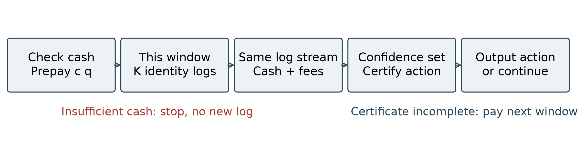
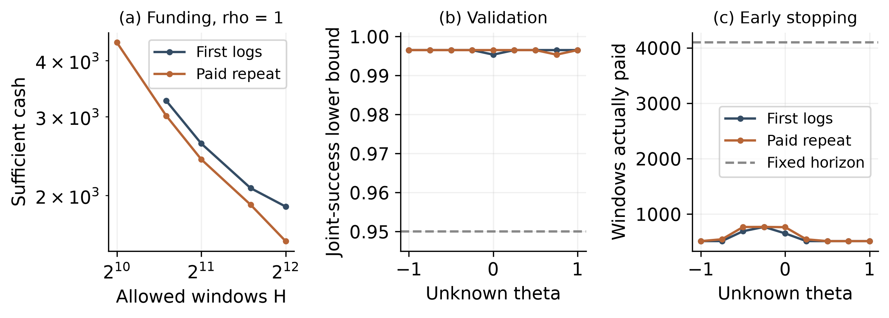

# 可靠行动的融资代价：反馈权限与资金—期限边界

2026年10月13日连续闭环修订评审稿。

## 摘要

逐次预付资源、成功收入回流，使可靠学习同时受到信息和现金风险约束。本文构造公共捕获读数及指定暴露矩完全相同的正机会任务，证明首次反馈的最低启动资金为Θ(ε⁻¹/²)，重复权限为Θ(ε⁻ᵝᵈ)，β_d=max{1/4,(d−2)/(2d−2)}；首次还具有Θ(ε⁻¹/²+ε⁻²/H)的资金—期限边界。必要界包含完整首次时刻及失败目录，资金结论可保留在每窗现金有界的协议中。已知模板、未知连续参数的推广增强结果适用范围。局部曲率收紧行动界后，一个有限规模案例完成连续估计、逐窗付款及行动输出的联合验证。结论不覆盖未知模型结构，也不把具体购买方案的成本比较当作最优权限排序。

## 1. 问题与贡献

一个搜索团队先支付资源费，随后才能取得机会收入。有限旧测试能支持稳健配置，却不能唯一决定真实最佳行动。若团队需要进一步辨别经营环境，测试期间的成功收入可以再投入，但也可能不足以支付下一次测试。本文问：在允许收入回流、必须逐次付款的条件下，可靠选择行动至少需要多少初始现金？增加同一机会的重复反馈，能怎样改变这个门槛？

我们始终比较同一个真实行动目标。本文没有把最高可能利润的置信上端与保守保证混作同一目标，也没有把累计资源、预期测试亏损和必须持有的现金混作同一预算。

本文在指定模型内给出两项核心结果。第一，在精确公共信息相同的合法机会世界中，首次和重复反馈具有匹配不同阶的最低资金。第二，首次反馈的最低资金和统计期限可以放在同一个联合前沿中。连续未知参数推广作为这两项结果的适用范围增强；局部行动界及有限闭环案例用于把核心机制做实。正测度校准、两点检验、矩优化、鞅极限及集中不等式均为已有工具；新增主张限于这些工具在指定信息及付款制度下给出的具体匹配边界。

## 2. 统一任务、观察与付款

机会速度z>0由非负有限测度ν描述。在单位窗口内，投入q的期望收入和净收益为

\[
P_\nu(q)=\int(1-e^{-qz})\nu(dz),\qquad f_\nu(q)=P_\nu(q)-cq.
\]

首消息收入归一化为1，资源费用c>0固定。机会窗口相互独立；每窗q∈[0,1]在看到当前机会池之前由过去日志决定，cq整笔预付且不可退还。不借款，没有安全外部现金，不复用跨窗机会，不在当前窗中改变q。可以在完成答案后停止，停付或永不输出均计为失败。闲置q=0不产生现金。

主协议为新生Poisson池N~Pois(M)，每身份速度独立来自ν/M。身份以速率qz产生消息，首消息付现金，后续消息只提供反馈。目录及未成功身份在窗末揭晓，原始z隐藏。M是期望机会数，不是实际现金路径上限。第6节另讨论每窗固定K身份的有界现金协议。

两种权限为：

- 首次反馈：全部首消息及精确时刻、窗末目录和失败身份免费。后续消息不可见。
- 重复反馈：仍有首次反馈，可以订阅后续身份消息；每条额外消息付χ，且可免费取消订阅。充分算法最多购买d条额外消息，χ固定且0≤χ<1/d。首奖励托管这些费用，净身份奖励保持非负。必要界允许把所有后续消息免费赠送，故实际收费不会削弱下界。固定采集启动费F≥0只在选择开通额外购买时收取；不购买不付F。没有重复权限强制门票，也没有免费首次日志的附加费用。

公共信息是旧规模收入p_k=P(k)，k=1,...,n，以及M和暴露矩B_j=∫z^jν(dz)，j=2,...,d。这些是精确先验约束；旧规模可以来自历史测试，并非当前q≤1的额外测量权限。本文对每个固定有限n和d构造某组公共值，不要求任意指定公共值都存在困难任务。

算法知道候选二元任务{ν_+^η,ν_-^η}和η，却不知道真实符号。目标是以每个世界至少1−δ的概率，在付款合法的条件下输出行动q_hat，使

\[
\max_{0\le q\le1}f_s(q)-f_s(\widehat q)\le\varepsilon_\eta,
\qquad \varepsilon_\eta=\tau\eta^{2d-2},\quad0<\delta<1/2.
\]

τ>0固定且充分小。两世界的合格行动集合不交，因而可靠行动必须辨别世界。这是相同答案精度，不以测试方案各自的收益尺度重新定义精度。

记B_j*(η,H)为权限j在不超过H窗内满足上述条件的启动余额下确界，允许任意跨窗随机、自适应和停止政策；H=∞仍要求有限时间输出的成功概率。常数可依赖固定任务、n、d、δ和收费合同，不对这些参数统一。

**命题0（权限包含）。** 对任何同一环境集合、同一精度ε、同一δ和期限H，在上述可不购买合同下，

\[
B_{\rm repeat}^*(\varepsilon,H)\le B_{\rm first}^*(\varepsilon,H).
\]

证明：任意首次政策在重复权限下原样执行，不订阅额外消息、不支付χ或F；它的现金路径、答案和停止时间均相同。取下确界即得。该关系同时适用于二元任务和第5节连续任务，亦适用于不可行时余额取正无穷的扩展值。若合同强制收取入场费，应另定义任务，不能沿用此排序。

## 3. 同一可靠目标的资金分离

**定理1（存在性资金边界）。** 对每个固定有限n≥1、d≥2，存在c>p₁、公共p、M、B₂,...,B_d及合法二元族，使这些公共量在两世界和全部充分小η上完全相同，且

\[
B_{\rm first}^*(\eta,\infty)=\Theta(\eta^{1-d}),
\]
\[
B_{\rm repeat}^*(\eta,\infty)
=\Theta\!\left(\max\{\eta^{2-d},\eta^{(1-d)/2}\}\right).
\]

可选择支付的固定启动采集费只改变购买上界的常数。没有每窗固定采集费。充分性使用上节明确托管合同；必要性覆盖免费赠送完整重复日志的更强实验。

用行动精度表示，同一结果为

\[
B_{\rm first}^*=\Theta(\varepsilon^{-1/2}),\qquad
B_{\rm repeat}^*=\Theta(\varepsilon^{-\beta_d}),\quad
\beta_d=\max\left\{\frac14,\frac{d-2}{2d-2}\right\}.
\]

| 固定d | 首次资金 | 重复资金 | 重复资金的主要限制 |
|---|---|---|---|
| 2 | ε⁻¹/² | ε⁻¹/⁴ | 等待证据时的现金波动 |
| 3 | ε⁻¹/² | ε⁻¹/⁴ | 波动与经营赤字同阶 |
| 4 | ε⁻¹/² | ε⁻¹/³ | 经营赤字 |
| 一般d≥4 | ε⁻¹/² | ε⁻⁽ᵈ⁻²⁾/⁽²ᵈ⁻²⁾ | 经营赤字 |

这不是说更高d使任务实际更容易。不同d对应不同合法族，隐藏常数和公共信息也不同；只能在同一个固定d任务中比较两种权限。

**机制与证明。** 以固定正慢机会作背景，加入质量Θ(η^d)、速度Θ(1/η)的快机会。正权重校准保持公共信息相同，快机会的一阶暴露不同，使最佳行动分离在Θ(η^(d−1))尺度。首次日志将快机会信号混入慢背景；全部精确首次时刻每窗KL仍不超过Cη^(2d−2)min(q,η)。重复日志利用同身份多次消息取得更强证据，但测试投入造成赤字。

现金下界不能由平均亏损代替。可靠判别强迫以固定正概率完成足够累计资源；若初始余额低于相应平方根尺度，归一化中心现金趋于从零出发的Brownian过程，不可能以固定正概率在整个必要前缀内保持可付款。重复反馈还需要普通资源和平方资源的双截断，给出另一个经营赤字下界。相应固定投入分类算法及下尾付款准备匹配两个下界。完整推导见附录A至I。

## 4. 首次反馈的资金—期限前沿

**定理2（联合边界）。** 沿用定理1同一个任务和制度。存在正固定常数c_δ,C_δ：

- H<c_δη^(−2d+1)时，即使初始现金任意大，首次反馈也不能可靠输出。
- H≥C_δη^(−2d+1)时，统一有

\[
B_{\rm first}^*(\eta,H)
=\Theta\!\left(\eta^{1-d}+\frac{\eta^{-4d+4}}H\right).
\]

重复反馈的统计期限为Θ(η^−d)，在H≥C'_δη^−d时即能以定理1的最低重复余额阶输出。最短期限两常数之间的准确可行边界没有声明。

转为行动精度：首次最低统计期限为Θ(ε⁻⁽²ᵈ⁻¹⁾/⁽²ᵈ⁻²⁾)，充分期限范围内

\[
B_{\rm first}^*(\varepsilon,H)
=\Theta\!\left(\varepsilon^{-1/2}+\frac{\varepsilon^{-2}}H\right).
\]

重复反馈期限为Θ(ε⁻ᵈ/⁽²ᵈ⁻²⁾)。首次要达到任意期限的最低余额阶，需要H达到ε⁻³/²阶；d=2时这与首次最短期限同阶，d>2时更长。

期限越短，首次方案必须提高投入以取得足够信息，经营赤字随之增加；延长期限可以减少这项赤字，但无法消除证据等待的现金波动项。联合必要界来自完整日志的信息门槛、期望付款账本与Jensen不等式。上界在H窗取q与η^(−2d+2)/H同阶，仅用成功次数分类，故能在更丰富首次权限下执行。详细常数分区见附录E。

## 5. 从二元判断到连续未知环境

端点构造还可形成连续族

\[
\nu_\theta^\eta=\frac{1+\theta}{2}\nu_+^\eta+\frac{1-\theta}{2}\nu_-^\eta,\qquad \theta\in[-1,1].
\]

各θ的测度正性、总量、公共捕获读数和指定暴露矩全部保留。环境参数θ未知，算法知道映射模板和η。以一套政策在每个θ上均成功概率至少1−δ定义连续任务余额 B_j,cont*，这是一致任务要求。

**推论3（主结果的连续任务推广）。** 对定理1同一构造及固定小τ，连续任务保持首次Θ(η^(1−d))、重复Θ(max{η^(2−d),η^((1−d)/2)})的任意期限余额。在 H≥C_δη^(−2d+1) 时，首次仍有Θ(η^(1−d)+η^(−4d+4)/H)的联合前沿；重复在H≥C'_δη^−d时达到其最小余额阶。

证明要点是把行动损失和参数精度联结。写f_θ=f₀+θg，先用端点导数确定包含所有最优行动的[0,Q]，再取这个区间上的κ_Q与L_Q，避免全域最差曲率。κ_Q在端点测度的q=Q处取最小；L_Q≤|g′(0)|+Q∫z²|Δν|(dz)，均为已知模板可算量。令q_h最大化f_h，最大点变分条件和强凹性给

\[
\max_q f_\theta(q)-f_\theta(q_h)\le
\frac{L_Q^2}{2\kappa_Q}|\theta-h|^2.
\]

因此把θ估计到一个与η无关、只依赖τ的精度便可完成真实近优行动。首次成功率是θ的仿射函数，在小投入q下其参数斜率为Θ(η^(d−1)q)、方差强度O(q)，需要N=O(η^(−2d+2)/q)窗。重复第d+1条事件率的参数斜率和总强度均为Θ(η^d)，需要N=O(η^−d)窗。仿射估计后投影到[-1,1]，再输出对应参数的最优行动；全区间统一的付款界与原端点算法同阶。端点属于连续族，故原必要界也适用。完整证明见附录I；局部常数及插值余项见I.2。

这确实扩大了上界适用的任务集合，但没有从公共读数推导出一维模型：模型模板是额外先验。支持、变化方向或η未知时，本文算法不再自动适用；一般兼容测度集合中的最优测量融资仍未解决。

## 6. 适用边界与已有研究

**确定实际现金上限。** 将Poisson池改为每窗恰有固定整数K份独立机会，可保持公共捕获响应；首现金为Binomial(K,P(q)/K)，每窗实际现金≤K。完整身份日志的KL与共同M=K的Poisson池一致，但现金分布不同。条件四阶矩和方差时钟仍支持定理1、2，因此无限实际奖励不是分离的必要条件。该扩展不把Poisson与Binomial数据说成同分布。

**改变付款或观察制度。** 若允许安全外部现金、提前免费预览当前目录、在当前窗改q、跨窗复用机会或赊付资源，原资金下界不能原样套用。首次反馈若每窗也收费w>0，长等待不再免费，余额规律需要重新推导。有稳定盈利基本行动时，先经营筹资也会改变启动资金问题。相关反例和推广保留在原始补充材料。这些条件是结论的经济内容。

**与已有结果的关系。** 生存约束和现金风险已由Riou、Honda与Sugiyama等研究；可靠选择与随机资源消费已由Li与Cheung研究；收益回流和带符号资源已出现在可补充预算研究中。本文可映射为带现金资源的学习问题，不能仅凭更换模型名称主张新颖。区别需落实到精确公共约束下的合法任务、可靠停止目标及匹配资金—期限定量结论。附录J的逐条件文献对照记录直接代入能推出什么以及不能直接推出什么；更宽框架中是否存在等价定理仍是原创性判断的范围限制。本文不以模型不能嵌入这些框架主张新颖：即使把有限投入视为臂，仍需把可靠停止强迫的信息前缀与实际预付现金联结，并在保留精确公共约束的替代分布内比较完整日志。已有遗憾或全分布类风险Pareto定理尚不能通过直接代入给出这里的匹配指数；本文的候选新增处仅是这组具体联立边界。

## 7. 连续任务的有限规模闭环案例

本节不复用二元分类结果作为连续任务验证。我们固定一个合法有限模板，实际执行参数估计、逐窗预付、收入与消息费结算、置信区间更新及行动输出。三种对比强度ρ=.6、.8、1在同一公共信息、同一费用、同一目标精度和同一期限下比较；ρ是已知任务宽度，θ∈[-1,1]未知。

**任务与单位。** 每窗恰有K=32个独立身份，速度节点为(.1,.4,1,3,10,30)。端点权重由三个线性等式M/K=1、P(1)/K=.5、B₂/K=25定义，所有权重严格正；具体六项权重与方程见附录K。故公共M=32、P(1)=16、B₂=800，资源单价c=48。所有方案目标ε=.064，期限H=4096，额外消息费χ=.005；至多购买两条，第三条后取消，不买不收费。首成功现金仍为1，金额是该收益单位，未折算成市场货币。各任务的最佳公共行动后悔均大于ε，不能不观察就给全区间一个合格答案。

图1：同一窗的消息同时决定证据、现金及费用。余额不足时先停止，不抽取该窗日志；已得到行动证书则立即停止，不继续花钱等待固定期限。

**策略与可复核保证。** 首次方案记录首时刻的8个等宽区间和失败类别。购买方案在相同区间内再区分总次数1、2、至少3，因而保留全部首次区间信息。两者都估计连续θ。以仿射类别概率构造有界得分和Bernstein置信区间，在10个预定检查点分配总统计错误.02。用第5节的局部行动界选择投入和最晚停止点；实际执行时，若当前置信区间端点的最坏行动损失≤ε便提前输出。插值行动和最优利润评价均保留梯度残差余项，未使用真实θ决定停止。

解析付款准备B_cert以最晚停止点的经营赤字与现金下尾构成；理想精确算术下，它和置信区间给全区间联合失败≤.04。另用独立试运行种子选取较小的B_trial，再用完全分离的验证种子检验。B_trial的证据只覆盖验证网格，不冒充全区间资金定理或最优B*。

| ρ | 方案 | 投入q | B_cert | B_trial | 验证中最差联合成功率 |
|---|---|---:|---:|---:|---:|
| 0.6 | 首次 | 0.02889 | 190.29 | 88.18 | 99.95% |
| 0.6 | 购买 | 0.02720 | 185.10 | 78.23 | 100.00% |
| 0.8 | 首次 | 0.02135 | 419.28 | 155.48 | 100.00% |
| 0.8 | 购买 | 0.02010 | 376.11 | 145.99 | 100.00% |
| 1.0 | 首次 | 0.03680 | 1889.18 | 317.87 | 99.95% |
| 1.0 | 购买 | 0.03261 | 1581.65 | 264.57 | 99.95% |

表1：同一目标、共同期限下的明确策略。投入来自预先声明的65点菜单，最小化解析充分准备；试运行仅选试验余额，没有使用验证样本调参。两个余额列均不表示全策略最小资金。

**完整验证。** 在3个ρ、9个θ、2种方案的54组中，每组独立运行2,000条有限余额路径，合计108,000条。每个窗口现场抽取其32个身份的联合日志类别，支付资源，利用同一类别计入现金和日志费，再更新估计；没有把终点成功数当作整条现金路径。联合成功要求合法付款、有限输出、真实行动误差达标，并且所有已计算参数置信集覆盖真实θ。所有路径实际最多使用1024窗，单次最多涉及32,768个身份；试验中最差联合成功率99.95%。参数失覆盖与停付的条件最高发生率各为.05%，没有超时或输出行动误差失败。对54组用Bonferroni校正的单侧Clopper-Pearson界，全部组的同时95%置信下界至少99.535%，超过95%目标。这个结论针对54个网格条件，不是连续区间的经验认证。

图2：(a)同一有限任务的菜单最低充分准备，曲线不是B*，缺点仅表示菜单没有证书而非所有策略不可行；(b)独立验证的联合成功率下界；(c)实际付款窗数，对照4096窗固定期限。早停直接降低经营消耗，而非只优化波动常数。

**现金和停止的反事实对照。** 在ρ=1、θ=−1的最亏损环境，主策略使用相同试验余额时两种方案均成功；将余额减为四分之一，或强制继续测到原最晚4096窗，分别在每项1,000条独立路径中全部停付。θ=0或1可出现经营收入覆盖测试消耗，控制组并不全部失败。这显示资金与环境、停止共同作用，也防止把融资说成平均测量账单。

购买方案的解析准备比首次方案低约2.7%、10.3%、16.3%，试验余额低约11.3%、6.1%、16.8%。这些是具体可执行方案的有限收益，不能据此给出权限最优余额的有限常数；重复权限仍可选择首次方案。独立的原始速度、指数首时刻和Poisson后续消息生成器还对80万个身份交叉核对类别律，未出现同时置信区间违例。

为检查首次时刻离散化是否人为制造优势，另将ρ=1首次方案的时刻区间细化到32和128格，重新优化同一投入菜单。得分信息从0.01097768趋至0.01097834，最低解析余额仍为1889.18。这里的8格解析策略比较对时刻分辨率稳定；这仍不能排除更一般的首次策略。

本例是已知有限模板的合成验证，既不是旧渐近族η指数的实测，也不是现实市场部署证据。它使用有意义的非零行动精度和适中的单次规模，把测量、付款和最终行动联合跑通；原η族的高精度、巨大等待继续保留为困难尺度诊断，见附录L。

## 8. 结论的用途与局限

本研究把同一可靠行动的统计难度与逐次可付款性联立：首次反馈的长证据等待会消耗现金安全余量，重复反馈能改变最低资金阶，却可能带来经营赤字。期限和现金的关系由明确任务族给出，固定公共读数和确定实际奖励上限均不能自动消除这一现象。

该结论属于已知模板、未知连续参数任务的高置信行动认证，二元端点用于建立必要界。它尚不解决任意未知兼容集合的最优采购，也不保证测试后相对所有免费学习政策净获利。有限闭环案例改善了可运行性证据，但真实机会速度、身份重复含义和收费合同仍未经市场数据校准。完整近邻的等价覆盖判断不能由有限搜索认证；论文的贡献应以具体条件定理和可复核证明为准。

## 参考文献

Riou, Honda and Sugiyama. The Survival Bandit Problem. TMLR, 2024. [作者v4](https://arxiv.org/html/2206.03019v4).

Li and Cheung. Best Arm Identification with Resource Constraints. AISTATS, 2024, PMLR238:253–261. [官方版本](https://proceedings.mlr.press/v238/li24c.html). 扩展：Learning with a Budget: Identifying the Best Arm with Resource Constraints, 2026. [作者版](https://arxiv.org/html/2602.24146v1).

Kanarios, Zhang and Ying. Cost Aware Best Arm Identification, 2024. [作者v2](https://arxiv.org/html/2402.16710v2).

Yang, Tan and Jin. Best Arm Identification with Minimal Regret. JMLR27(86):1–41, 2026. [官方版本](https://jmlr.org/papers/volume27/24-1612/24-1612.pdf).

Kumar and Kleinberg. Non-monotonic Resource Utilization in the Bandits with Knapsacks Problem, 2022. [作者版](https://arxiv.org/html/2209.12013v1).

Bernasconi, Castiglioni, Celli and Fusco. Bandits with Replenishable Knapsacks: the Best of both Worlds. [作者v1，2023](https://arxiv.org/html/2306.08470v1).

Whitt. Proofs of the martingale FCLT. Probability Surveys4:268–302, 2007. [作者原文](https://www.columbia.edu/~ww2040/WWproofs2007pub.pdf).

# 附录：完整证明与案例方法

## A. 合法公共信息与真实近优集合

选d+1个不同正快节点x_j。矩阵行1,x²,...,x^d满秩，其零空间向量u非零。由广义Vandermonde可知Σu_jx_j≠0；否则0至d阶全部抵消将迫使u=0。缩放后取正权重σ_sj=σ_0j+s t u_j，t>0充分小，使两组总质量和二至d阶矩相同、一阶不同。d+1阶也不同：多项式∏(x−x_j)=0在各节点成立，代入u只保留x^(d+1)和x项，得到Σu x^(d+1)为非零常数倍Σu x。

函数1,g₁,...,g_n,z,z²,...,z^d，其中g_k(z)=1−e^(−kz)，在任意正开区间线性独立。解析延拓后z趋无穷先消去高阶多项式，最后依次消去指数项。因此可选n+d+1个固定不同正慢节点z_i，使对应评价方阵V可逆。

固定严格正慢权重m⁰，总量M=K>0；设p_k=Σm⁰_i g_k(z_i)、B_j=Σm⁰_i z_i^j，c=Σm⁰_i z_i。固定正节点使c>p₁。加入快测度bη^dΣσ_sjδ_(x_j/η)，其中b>0固定且充分小。令慢权重

\[
m_s^\eta=m^0-V^{-1}r_s^\eta.
\]

r在总量、g_k和二至d阶行取快测度贡献，一阶z行取0。这样公共M、p及B₂,...,B_d精确不变，慢一阶恰为c。校准负载一致O(b)，故固定足够小b保证所有慢权重为正。两世界校准差只来自捕获读数快指数尾，为O(η^d e^(−x_min/η))。每个η测度均有限且支持严格z>0。公共捕获读数属于其可实现集合内部；正文不要求这些公共值任意指定。

令f_s(q)=P_s(q)−cq。统一有

\[
\ell q\le P_s(q)\le Cq,\quad
f_s(q)\le A\eta^{d-1}q-\kappa q^2/2,\quad
f_s(q)\ge-B_2q^2/2.
\]

第一式和统一κ>0来自固定正慢背景，最后一式来自P_s'(0)>c及总二阶矩固定。

d>2时，q=η^(d−1)t使f_s(q)/η^(2d−2)在紧t区间一致趋于bμ_s t−B₂t²/2，μ_s=Σσ_s x不同。d=2时极限为bΣσ_s(1−e^(−tx))−B₂,slow t²/2，B₂,slow共同且正；b充分小时两个正最优点仍不同。统一曲率界将全域最优限制在该尺度。故可选τ>0，使ε_η=τη^(2d−2)近优集合A_+,A_-不交。分类正确后输出相应世界的精确最优行动即可合格；反向用A_+、A_-把任何可靠行动输出映为可靠二点判断。

## B. 全部首次与重复日志的信息核

以K_s(q)表示两个方向任一单窗KL；以下C均可统一控制两方向。Poisson池首次成功时间强度

\[
h_s(t)=q\int z e^{-qtz}\nu_s(dz),\quad 0\le t\le1,
\]

失败强度λ₀s=∫e^(−qz)ν_s(dz)。目录是成功加失败之和，不再额外视作独立信息。固定慢背景给h_s≥c₀q、λ₀s≥c₀。

慢差指数小，快差满足

\[
|h_+-h_-|\le Cq\eta^{d-1}e^{-qx_{\min}t/\eta}+Cq\eta^d e^{-x_{\min}/\eta}.
\]

用Poisson KL≤χ²，成功部分积分为O(η^(2d−2)min(q,η))。共同快质量和总量使失败差≤Cη^d min(q/η,1)+Cqη^d e^(−x_min/η)，其χ²也受同一界控制。因此

\[
K_{\rm first}(q)\le C\eta^{2d-2}\min(q,\eta).\tag{B1}
\]

q=0时只有同目录，KL=0。精确首时刻已全部包含。

重复完整实验中，给定身份次数，消息时刻是均匀次序统计，条件分布不依赖类型。q≤η时可用更强实验：次数0、1隐藏原始类型，次数≥2免费揭示类型。0次数χ²为O(q²η^(2d−2))，1次数强度≥c₁q、差O(qη^(d−1))，给O(qη^(2d−2))。各快类型全部高次数贡献为

\[
C\eta^d\Pr\{\operatorname{Pois}(qx_j/\eta)\ge2\}
\le C\eta^{d-2}q^2,
\]

使用二阶阶乘矩直接包含无限尾。q≥η时赠送全部类型，KL≤Cη^d。这些赠送只用于信息上界，不交给真实付款算法。统一得到

\[
K_{\rm repeat}(q)\le C\eta^{2d-2}q+C\eta^{d-2}q^2,\tag{B2}
\]
\[
K_{\rm repeat}(q)\le C\eta^{d-1}q,\qquad
K_{\rm repeat}(q)\le C\eta^d.\tag{B3}
\]

跨窗q可预测，任意有限日历或资源截断由条件KL链处理。每窗中途停止的日志是全窗实验的数据处理，仍受全窗界控制。无限期限政策先作有限日历定位，再取极限；不假设停止时间独立。

## C. 实际现金的波动下界

所有日志及现金均适应实际窗末过滤F_i。q_i在开窗前可预测，资源cq_i预付；不条件于未来整条投入路径。

**引理C1（付款存活）。** 若首现金Y_i的中心增量D_i=Y_i−μ_i、方差v_i满足

\[
\mu_i-cq_i\le aq_i,\quad
\ell q_i\le v_i\le Cq_i,\quad
E(D_i^4\mid\mathcal F_{i-1})\le C_4v_i,
\]

则对于任意T→∞、a√T≤1，若B=o(√T)，政策完成累计资源至少bT的概率趋0，b>0固定。非负日志费用可删除，但不提前赠送现金。

**证明。** 反设存在子列使完成该资源的概率≥p>0。为各参数选择有限确定日历J，使J内完成概率≥p/2。停付、停止输出或到达J之后，仅在证明空间用独立Bernoulli(1/2)减去1/2的中心增量延长鞅，令延长窗q=1、v=1/4；必要时缩小ℓ、增大C及C₄，保持统一矩界并保证累积方差发散。漂移付款条件仅用于真实前缀，不用于延长窗。延长不供给真实政策现金或日志；成功事件上的必要真实前缀不变。

令 M_j=Σ_(i≤j)D_i、V_j=Σ_(i≤j)v_i，定义

\[
\tau_T(t)=\min\{j:V_j>Tt\},\quad
\mathcal G_t=\mathcal F_{\tau_T(t)},\quad
N_T(t)=\frac{M_{\tau_T(t)}-M_{\tau_T(0)}}{\sqrt T}.
\]

可预测性给 {τ_T(t)≤j}={V_j>Tt}∈F_(j−1)，所以τ_T(t)是停止时刻。严格超过号给右连续时间改变；零方差步骤的D_i几乎必然为零，不造成合并跳跃。且V_(τ_T(t))∈(Tt,Tt+C]。先对τ_T(t)∧m使用离散鞅等距，再由停止增量的L²收敛，可得

\[
E M_{\tau_T(t)}^2=E V_{\tau_T(t)}\le Tt+C,
\qquad E M_{\tau_T(0)}^2\le C.
\]

这里停止增量的尾L²范数由被停止方差的可积尾控制；不需Eτ_T(t)有限。故可选采样适用，N_T对G_t为零初值鞅，减去的初项在√T尺度L²消失。

时间改变后的可选二次变差为

\[
[N_T](t)=\frac1T\sum_{\tau_T(0)<i\le\tau_T(t)}D_i^2.
\]

H_j=Σ_(i≤j)(D_i²−v_i)为鞅，其条件二阶矩增量≤C₄v_i。停止Doob界给

\[
E\sup_{j\le\tau_T(t_0)}|H_j/T|^2
\le4C_4(Tt_0+C)/T^2\longrightarrow0.
\]

连同方差时钟越界界、初始可选变差的L¹消失，得到[N_T](t)→t，甚至在有界区间上一致依概率。四阶条件还给

\[
E\max_{i\le\tau_T(t_0)}\frac{|D_i|}{\sqrt T}
\le\left(\frac{E\sum_{i\le\tau_T(t_0)}D_i^4}{T^2}\right)^{1/4}
\le\left(\frac{C_4(Tt_0+C)}{T^2}\right)^{1/4}\longrightarrow0.
\]

满足Whitt (2007) Theorem2.1(i)的初值、期望最大跳跃和可选变差条件，故N_T收敛到标准Brownian运动W。

任意真实已完成前缀，非负余额要求

\[
M_j\ge-B-a\sum_{i\le j}q_i\ge-B-aV_j/\ell.
\]

在完成bT资源的事件内，取0<t₀<ℓb/4，充分大T下整个[0,t₀]的逆时钟均落在已完成的真实前缀。于是

\[
\inf_{0\le t\le t_0}\left(N_T(t)+\frac t\ell\right)\ge-e_T,
\quad
e_T=\frac B{\sqrt T}+\frac{|M_{\tau_T(0)}|}{\sqrt T}
+\frac{aC}{\ell\sqrt T}\longrightarrow0
\]

依概率成立，且使用了a√T≤1。对任意固定r>0，完成事件概率不超过P(e_T>r)+P(inf(N_T+t/ℓ)≥−r)。在连续极限处inf泛函连续，Portmanteau给其极限上界P(inf(W+t/ℓ)≥−r)。再令r↓0，该概率趋0：Brownian从零出发即向线性边界下方波动。和p/2矛盾，证明引理C1。

**引理C2（信息强迫融资）。** 若答案在端点世界中可分，固定δ<1/2可靠政策每窗条件KL≤kq_i，k→0、a→0，并满足C1条件，则

\[
B=\Omega\bigl(\min\{k^{-1/2},a^{-1}\}\bigr).
\]

在累计承诺资源首次达到S=b/k时截断，最后越界≤1。截断KL≤b+k。原可靠输出的总变差至少ρ=1−2δ；截断实验总变差至多√((b+k)/2)。耦合原政策及其截断，两个世界达到门槛的概率之和至少ρ−√((b+k)/2)。取固定小b，至少一个世界有固定正到达概率；达到门槛前已完成资源至少S−1。

令T=min{1/k,1/a²}，约定a=0时a⁻²=∞。有S/T≥b、a√T≤1。充分大T下，S−1≥(b/2)T；若B=o(√T)，对门槛(b/2)T应用C1令该到达概率趋0，矛盾。排除所有趋零子列即给出Ω界。

Poisson现金有v=μ、E D⁴=μ+3μ²；固定K现金有v=μ(1−μ/K)、E D⁴≤K²v。正慢背景、q≤1和p₁<K保证统一方差可比。首次取k=Cη^(2d−2)、a=Aη^(d−1)，得到Ω(η^(1−d))；重复取k=Cη^(d−1)，得到Ω(η^((1−d)/2))。

## D. 重复反馈的赤字下界

d≥3令L=η^(2−d)，反设B=o(L)。在普通资源Σq达到L²或平方资源Σq²达到bL时截断，越界≤1。由(B2)，截断KL≤Cη^(2d−2)(L²+1)+Cη^(d−2)(bL+1)=Cb+o(1)。

普通门槛到达概率趋0：用引理C1，T=L²，B/√T→0、a√T=O(η)→0，完成该资源需要固定正归一化方差区间。此步只用付款风险，不把重复实验错误地替换为首次线性信息界。

平方门槛由期望账本控制。删除非负日志费用，给予已经预付末窗的最终首收入，但不提前用于付款。记I_i为第i窗已启动的指示，I_i及启动投入在开窗前可预测。账本只记已启动窗；免费完成已预付末窗的Y_i但不提前交付，删除费用后终止余额非负。条件期望E(I_iY_i)=E(I_iμ_i)给

\[
\frac\kappa2 E\sum I_iq_i^2\le B+aE\sum I_iq_i
\le B+a(L^2+1).
\]

有限日历先截断，可积；再由单调或受界极限延长。到达bL的概率≤2[B/L+a(L²+1)/L]/(κb)→0。原可靠实验与低KL截断实验的总变差差趋0。b充分小则Pinsker与1−2δ矛盾。故B=Ω(L)。d=2时L常数，C节波动项更强，不能硬套发散L论证。

## E. 期限与期望账本

B1给首次每窗KL≤Cη^(2d−1)，B3给重复每窗KL≤Cη^d。可靠二点判断需要固定正KL，分别得到H=Ω(η^(−2d+1))和H=Ω(η^−d)。

令D_δ=(1−2δ)log((1−δ)/δ)>0，为可靠二点输出的双向KL下界。在至多H窗的首次政策下，换测度给s=E_+Σq_i≥D_δ/k，k=Cη^(2d−2)。对已启动窗完成账本，仅下界赠送末窗最终首现金；启动指标I_i和q_i对过去可测。因此EΣI_iY_i=EΣI_iP_+(q_i)，而非假定停止与收入独立。非负余额给

\[
B\ge\frac\kappa2E\sum q_i^2-as
\ge\frac{\kappa s^2}{2H}-as.
\]

H≤κD_δ/(4ak)时，右侧在s≥D_δ/k上递增，给B≥κD_δ²/(4k²H)。H更大时1/(k²H)已受常数倍k⁻¹/²控制，C节任意期限波动下界承担它；这里使用本任务a=O(√k)，不是任意现金模型都具有同一联合前沿。max与和固定常数等价，得到Ω(η^(1−d)+η^(−4d+4)/H)。这一步没有把平均资源要求偷换成每条路径要求。

## F. 匹配的分类和付款方案

在0<q≤αη，固定足够小α使|P_+−P_-|≥c_Δη^(d−1)q、P_s≤Cq，统一成立。两世界快一阶不同；慢校准差在q=0恰抵消，导数指数小，不能以不含q的指数小界替代统一小q推导。

首次给定H≥C_δη^(−2d+1)，取q=A_δ/(η^(2d−2)H)。增大C_δ使q≤αη。H窗成功次数有均值差至少固定常数倍标准差，选择A_δ充分大使分类错误≤δ/2。Poisson用标准Chernoff；固定K用Bernoulli/binomial集中。净均值≥−B₂q²/2，累计非负首收入的中心下尾控制给准备

\[
B\le cq+\frac{B_2}2Hq^2+
\sqrt{2CHq\log(2/\delta)}
=O(\eta^{-4d+4}/H+\eta^{1-d}).
\]

这里公式表示明确足够余额，而非所有政策的上限。预付款cq单独加一次，成功现金实际回流。任意期限首次取q=O(η^(d−1))、N=O(η^(−3d+3))，给O(η^(1−d))。

重复取q=αη，看到第d+1次消息后取消。快身份该事件率差Θ(η^d)，慢背景尾为O(η^(d+1))，非退化来自A节d+1矩差。N=C_δη^−d窗分类足够。最多d条额外消息由首奖励托管，χ<1/d，净身份奖励W∈[0,1]。慢额外费用O(q²)、快费用O(η^d)，每窗净亏损≤Cη²，二阶奖励强度≤Cη。于是

\[
B\le F+c\alpha\eta+CN\eta^2+
\sqrt{2CN\eta\log(2/\delta)}
=O(\max\{\eta^{2-d},\eta^{(1-d)/2}\}).
\]

对任意非负W，e^(−tW)≤1−tW+t²W²/2，故中心下尾的对数母函数≤t²EW²/2。独立窗或标记Poisson的指数超鞅及Ville界同时控制所有计划前缀；付款政策与不中断计划在首次停付前一致。δ/2分类与δ/2付款用并集界，不要求失败独立，也不以未来部署支付测试费用。

固定K池分类信号阶不变，独立身份和窗口的非负有界净奖励同样满足上述下尾界。完整KL等于K倍单身份KL，与共同Pois(K)目录实验相同。此处只复用信息核，现金风险已另证。

## G. 精度转换与有限尺度审计公式

ε=τη^(2d−2)，故首次余额η^(1−d)对应ε⁻¹/²，重复对应ε⁻max{1/4,(d−2)/(2d−2)}；联合项η^(−4d+4)/H对应ε⁻²/H。首次与重复最低期限分别对应ε⁻(2d−1)/(2d−2)和ε⁻d/(2d−2)。常数τ固定才能这样转换。

本次独立核验采用K=1、d=2，重复第三条后取消。首次样本有失败概率p₀s和首时刻密度h₁s(t)=Σw_s λe^(−λt)，λ=qz。重复样本在次数k=0,1,2时概率p_ks=Σw_s e^(−λ)λ^k/k!；第三次发生于t≤1时密度t²Σw_sλ³e^(−λt)/2。给定次数或第三时刻的先前时刻为世界无关条件分布，故这些是完整取消日志的似然充分量。

两实验亲和度A分别为离散类别的Σ√(p_+p_-)加对应连续密度的∫√(h_+h_-)。似然比阈值1的每世界错误≤A^N。N取ceil(log(1/.025)/(−log A))。用1−A的平方根差积分评价，避免A接近1时相减丢精度。

首现金及托管收费后的净奖励分布为首次(0,1,1,1)、重复(0,1,1−χ,1−2χ)，对应类别0,1,2,≥3。固定方案足够准备

\[
B=cq+N\max_s(cq-E_sW)_+
+\sqrt{2N\max_s E_sW^2\log(1/.025)}.
\]

两方案可使用不同N≤同一H；完成即停止。有限菜单的最小充分余额不是全政策最小余额。数值积分误差、归一化误差、公共约束残差、预期现金和日志费用均保存在JSON；普通浮点评价不构成严格区间证书。

## H. 证明工具与追溯

上述必要界覆盖任意可预测、随机、自适应及停止政策；充分界由具体独立窗口算法给出。固定δ、η趋零及已知模板是全部量词的一部分。原始分量材料保留，供追溯不同版本。

使用Whitt (2007) Theorem2.1(i)，[原文](https://www.columbia.edu/~ww2040/WWproofs2007pub.pdf)。

## I. 连续任务族：统一估计与行动损失

沿用附录A的端点构造，令

\[
\nu_\theta^\eta=\frac{1+\theta}{2}\nu_+^\eta+
\frac{1-\theta}{2}\nu_-^\eta,\qquad -1\le\theta\le1.
\]

正性和公共约束对测度都是线性的，因此每个θ对应合法正世界，具有完全相同的p、M和B₂,...,B_d。慢校准权重和快权重都是θ的仿射函数。θ是未知环境参数；算法知道整个映射θ↦ν_θ^η，但不知真实θ。

以区间上每个θ均满足付款与答案成功概率至少1−δ定义 B_j,cont*(η,H)，只允许一套算法及同一初始余额。该量不是各θ点态最小余额的上确界。由于端点属于连续族，二元任务的任何必要界直接给出连续族的必要界。

**推论3（连续族的匹配界）。** 在正文定理1、2相同固定参数和收费条件下，存在上述连续族，使

\[
B_{\rm first,cont}^*(\eta,\infty)=\Theta(\eta^{1-d}),\quad
B_{\rm repeat,cont}^*(\eta,\infty)
=\Theta\bigl(\max\{\eta^{2-d},\eta^{(1-d)/2}\}\bigr).
\]

在 H≥C_δη^(−2d+1) 时，首次连续任务统一满足

\[
B_{\rm first,cont}^*(\eta,H)
=\Theta\left(\eta^{1-d}+\eta^{-4d+4}/H\right).
\]

首次统计必要期限仍为Ω(η^(−2d+1))；重复必要期限为Ω(η^−d)，重复上界在H≥C'_δη^−d时达到。常数还可依赖固定τ。这里不主张η未知、支持未知或所有公共约束兼容世界都可由该算法处理。

### I.2 局部行动损失及数值行动余项

写 f_θ=f₀+θg，θ∈[-1,1]。选Q∈(0,1]，使两端点都满足f₋′(Q)≤0、f₊′(Q)≤0。由于导数对θ仿射、f_θ严格凹，整个连续族的最优点均落在[0,Q]。Q可由端点最优点的上括界取得，不用未知真实θ选区间。

定义

\[
\kappa_Q=\min_{s\in\{-,+\}}\int z^2e^{-Qz}\nu_s(dz),
\qquad T_2=\int z^2\left|\frac{\nu_+-\nu_-}{2}\right|(dz).
\]

由于曲率绝对值对q单调递减、对θ仿射，κ_Q在整个已知最优区间与整个参数区间上有效。由g′(q)=g′(0)+∫₀^qg″(u)du，可取

\[
L_Q=|g'(0)|+QT_2.
\]

亦可将[0,Q]划为宽度h的网格，使用更紧、仍带解析余项的界

\[
L_Q\le\max_j|g'(t_j)|+\frac h2T_2,
\]

其中t_j为各格中点；实现若采用含两端点的等距网格，则每个点至最近网格点距离≤h/2，公式同样有效。这不是把网格最大值直接当连续区间上界。

令q_h最大化f_h。真最优点q_θ与q_h都在[0,Q]，因此原强凹证明只需在这个区间内执行，得到

\[
\max_qf_\theta(q)-f_\theta(q_h)
\le\frac{L_Q^2}{2\kappa_Q}|\theta-h|^2.\tag{I1-local}
\]

对于有限节点模板，κ_Q和T₂均是显式有限和。Q=O(η^(d−1))且T₂=O(1)，g′(0)=O(η^(d−1))，所以L_Q=O(η^(d−1))，原资金及期限指数完全不变。改进来自更准确的有限常数。

如果采用数值行动表返回近似q_h，则必须补上残差。若|f_h′(q_h,approx)|≤e且该行动也在[0,Q]，有

\[
\max_qf_\theta(q)-f_\theta(q_{h,\rm approx})
\le\frac{(L_Q|\theta-h|+e)^2}{2\kappa_Q}.
\]

本次案例采用20,001点参数表、端点根的二分求解和线性插值；通过最优行动映射的L_Q/κ_Q Lipschitz界以及最大曲率B₂，给插值梯度误差显式上界，实际停止证书保留该余项。

#### 置信区间驱动的停止

在有限案例中还直接计算候选行动q对置信区间[a,b]的最坏收益损失。函数V(θ)=max_q f_θ(q)是仿射函数上确界，故V(θ)−f_θ(q)对θ凸。在闭区间上最大值由端点取得：

\[
\sup_{\theta\in[a,b]}\{V(\theta)-f_\theta(q)\}
=\max\{V(a)-f_a(q),V(b)-f_b(q)\}.
\]

因此可在预定检查点给出行动证书并提前结束，而不等待固定的、对所有θ最差的参数半径。端点V的数值评价用梯度残差与κ_Q补成上界，不把插值利润直接冒充精确最优利润。

上述所有常数的程序评价使用普通双精度；解析式有明确余项，数值文件不冒称严格区间算术证书。

取参数半径r_η=min{1,√(2κ_Qε_η)/L_Q}。沿渐近族它有统一正下界，可取不依赖η的固定较小半径，故下列估计复杂度与原指数相同。

### I.3 首次统一估计

记 P_θ(q)=P₀(q)+θΔP(q)，ΔP=(P₊−P₋)/2。附录F给在0<q≤αη下

\[
|\Delta P(q)|\ge c_\Delta\eta^{d-1}q,\qquad P_\theta(q)\le Cq.
\]

在N个固定投入窗记录全部首成功数X。Poisson池下X~Pois(NP_θ(q))；固定K下为NK个成功概率P_θ(q)/K的Bernoulli和。估计

\[
\widehat\theta=\operatorname{clip}_{[-1,1]}
\left(\frac{X/N-P_0(q)}{\Delta P(q)}\right).
\]

投影不增加相对真实θ的误差。标准Poisson/Bernoulli尾界使误差>r的概率至多δ/2，只需

\[
N\ge\frac{C_{\delta,r}}{\eta^{2d-2}q}.
\]

期限H≥C_δη^(−2d+1)时，取N=H、q=A_(δ,r)/(η^(2d−2)H)，确保q≤αη。所有θ的期望经营亏损、奖励二阶强度统一受附录F相同界控制，故同一个准备余额

\[
B=cq+\frac{B_2}2Nq^2+
\sqrt{2CNq\log(2/\delta)}
\]

同时控制全区间付款失败概率≤δ/2。不限期限取q=O(η^(d−1))、N=O(η^(−3d+3))。输出 q_θhat 后由(I1)和并集界完成首次充分性。此算法估计连续参数，输出不限定在两个端点行动。

### I.4 重复统一估计

取q=αη，看到第d+1条消息后取消。以该标记身份的每窗期望数λ_θ(q)=λ₀(q)+θΔλ(q)作统计量。附录A的d+1阶矩差保证可取固定小α>0，使

\[
|\Delta\lambda(q)|\ge c\eta^d,\qquad
0\le\lambda_\theta(q)\le C\eta^d.
\]

快身份贡献为η^d乘固定解析尾函数；其首个非零差项由d+1阶矩给出。慢背景尾为O(η^(d+1))，校准差更小。N窗标记次数也是Poisson或Bernoulli和，用与首次相同的仿射估计并投影，N≥C_(δ,r)η^−d便把参数误差控制在r内。

每身份最多购买d条额外消息，χ<1/d保证净现金非负。期望亏损O(η²)与奖励二阶强度O(η)在θ全区间统一；附录F的付款准备给

\[
B=F+c\alpha\eta+CN\eta^2+
\sqrt{2CN\eta\log(2/\delta)}.
\]

α为固定投入系数，θ为未知环境参数；F只在选择启动购买时支付。由(I1)完成全区间充分性；由端点必要界完成推论3。

### I.5 适用边界

解决：单一连续任务上统一的可靠行动；算法不预知真实参数，也不只输出两个预设答案；匹配资金与首次期限阶不变。

未解决：未知模型结构下的测量设计、任意兼容测度集合上的最优融资、未知η和收费下的最优自适应采购。公共读数本身不能把所有合法测度压缩为本文的一维模板；这一模板是额外先验。
## J. 核心命题与最近邻的逐条件对照

以下用固定K现金有界版本排除“仅因奖励无界而不同”的表面区别。投入菜单离散化可以映射为臂，但连续行动近优误差需另行控制。

| 条件 | 本文核心定理 | Survival Bandit，§3/Prop.26 | BAIwRC，§3 | Replenishable Knapsack，§2/Thm.6 |
|---|---|---|---|---|
| 未知环境 | 已知模板、未知θ；端点供必要界 | 未知臂分布类 | 未知奖励/消费联合分布 | 未知收益及带符号消费 |
| 可靠目标 | 固定δ，真实ε近优停止答案 | 生存遗憾与破产风险 | 固定资源下识别成功概率 | 累计收益/LP基准遗憾 |
| 收入回流 | Y−cq，收入可再付资源 | 带符号臂奖励改变余额 | 原消费支持[0,1] | 带符号消费可表达回流 |
| 预付时点 | 开窗前持有cq | 余额触底终止 | 累计消费不得超预算 | 算法余额安全门槛 |
| 可闲置但不增资 | q=0，零现金 | 不提供本文同一机会闲置协议 | 正均值消费 | void允许β=0；可含本文闲置 |
| 精确公共约束 | p、M、B₂至B_d完全相同 | 指定风险定理不保持这些约束 | 未给本文捕获矩校准 | 未给本文捕获矩校准 |
| 完整日志对照 | 首时刻/失败目录对重复全日志 | 单臂现金奖励反馈 | 奖励/消费反馈 | bandit收益及消费 |
| 匹配目标量 | 最小现金阶及首次B-H前沿 | 全分布类Pareto风险 | 固定资源识别难度 | 遗憾含预算参数 |

对照结论分为三层：BAIwRC中的“以cq−Y代消费”因符号不符而不能直接套用；Survival/BwRK模型则可以容纳重要机制，只是已读指定定理的目标、量词和公共约束不同；是否用其方法及新信息核可推出本文结论，仍可能，不能转述为理论完全不可归约。

最近邻均已有学习、随机资源和生存风险。本文的待评审新增主张只在正机会校准与完整日志信息核联立后产生的精确匹配阶及前沿；连续族扩展是本文任务内部的拓宽，不代表超越上述未知分布理论的总体宽度。

## K. 有限闭环案例的定义、置信及现金证书

以A的三行为1、1−exp(−z)、z²，右端为(1,.5,25)。正端点在节点索引1、2、5固定权重10⁻⁴，解其余0、3、4三权重；负端点固定0、3、4，解1、2、5。索引从0开始。结果约为

- 正端点：(0.53970410, .0001, .0001, .23181432, .22818158, .0001)。
- 负端点：(.0001, .46988951, .50268691, .0001, .0001, .02712359)。

此处有限小数用于阅读，程序和模型用上述线性方程定义精确公共约束。模型为ν_θ,ρ=KΣ(w₀+ρθΔw)δ_z，K=32。ρ三值都不改变M、P(1)及B₂。每窗首现金≤32。公共行动的最小最大后悔分别约为(.184,.319,.483)，均大于目标.064；无需新日志的固定答案不合格。该参考模板的有限规模与主η族不同，不能拿本例ρ变化拟合主定理指数。

行动表及程序内曲率先按单身份归一化，精度为.002；整体收益与精度都乘K=32，统计和资金按整窗计算。

本例所有参数的最优点均为内点：最小P′(0)约1.50566>1.5，而P′(1)<.5<1.5。因此数值行动插值的梯度余项可以用B₂乘动作误差控制，未在边界点错误假定梯度为零。

令λ=qz，首时刻区间[a,b]。首次类别概率为exp(−λa)−exp(−λb)，失败为exp(−λ)。重复在该区间内的总次数1、2概率分别为λexp(−λ)(b−a)与λ²exp(−λ)[b−a−(b²−a²)/2]；第三及更多类别为首次区间概率减去这两项。它们相加恰为首次类别，故购买算法没有丢弃首次信息。净奖励为0、1、1−χ、1−2χ；这些费用在首现金托管范围内支付。

任一方案的单身份类别概率p_θ=a+θb。令t_l=b_l/a_l，I=Σb_l²/a_l>0，则E_θt=θI。方差为v₀+θv₁−θ²I²，故v_max可在闭区间上直接最大化。R=2max|t_l|为有效的中心增量范围界。N窗包含KN个独立身份，用J=10个固定检查点、统计错误δ_s=.02，半径取

\[
r_N=\frac{\sqrt{2v_{\max}\log(2J/\delta_s)/(KN)}
+2R\log(2J/\delta_s)/(3KN)}{I}.
\]

分母I不可省略：原始得分波动须转换成参数误差。双侧Bernstein及检查点并集界使所有检查点同时覆盖真实θ的概率至少.98，适用于全区间每个θ。先在完整计划空间定义日志；实际停付之前与该计划耦合，现金与得分相关无需独立。

选择65个对数均匀候选q∈[.005,.24]。最晚停止点N_cap取局部界连同插值误差已保证ε的第一个检查点。按该N_cap计算

\[
B_{\rm cert}=cq+N_{\rm cap}d(q)
+\sqrt{2N_{\rm cap}\psi_2(q)\log(1/\delta_c)},
\quad\delta_c=.02.
\]

这里w为单身份净奖励，d(q)=max_θ(cq−K E_θw)_+、ψ₂(q)=K max_θ E_θw²。二阶项使用独立非负身份奖励的母函数强度，不是整窗总奖励的二阶矩；均值亏损按整窗读取。

该金额在精确模型中统一覆盖全部计划前缀。统计与付款失败并集上界.04，独立性不必要。早停证书使用置信区间端点的最大行动后悔；最优利润上界加梯度残差项，保留插值误差。

试验余额B_trial来自每个设计5个θ的400条试运行路径：取各条件所需启动现金的99.5%经验分位最大值，乘1.2再加一次预付款。试运行、验证、控制组、原始消息生成器各有独立预先固定种子。该经验选款法无全区间概率证明，因此只用独立验证评估，不与B_cert混称。

最终验证3×9×2个条件，每个2,000条路径；Clopper-Pearson单侧置信错误取.05/54，给全部条件同时95%下界。每窗在付款前检查现金；不足则停止且不再观察。局部插值返回连续行动，不限制在两个端点答案。程序另记录置信覆盖、停付、超时、行动失败、付款窗数、资源、费用和现金最小值。完整路径模拟用逐窗多项分布生成32个独立身份的联合类别，是同一窗的精确聚合，绝非跨时间终点抽样。独立原始生成器抽隐藏速度、指数首次等待及余窗Poisson消息，用于检查该类别律。

数值采用双精度，解析余项与统计区间均显式；不称为严格区间算术认证。

## L. 原困难尺度与局部常数的诊断

旧η族的巨大分类窗数不能被本有限模板替代。它仍保留精确公共约束、固定设计双向KL必要界和现金分解；该诊断不认证任意自适应策略的有限最小资金。本轮只收紧其行动界，未把难例改成易例后声称解决原规模。

| η | 旧/新行动界系数 | 允许参数误差倍数 | 网格最大实际损失/新界 |
|---|---:|---:|---:|
| 0.05 | 3200.6 | 56.57 | 0.7791 |
| 0.1 | 3200.6 | 56.57 | 0.7790 |
| 0.2 | 3503.2 | 59.19 | 0.7766 |
| 0.3 | 5751.2 | 75.84 | 0.7533 |

该表覆盖原来的808个非零参数误差行动对。界系数缩小约3200至5751倍，允许参数半径约增大57至76倍；这可能按半径平方改善测量充分窗数，不是所有估计器的实际测量倍数。网格最大比值接近.779不证明全域紧常数。
