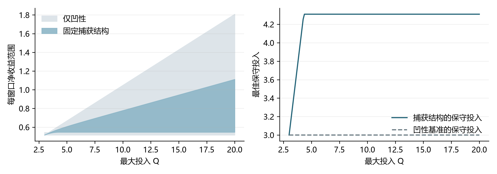
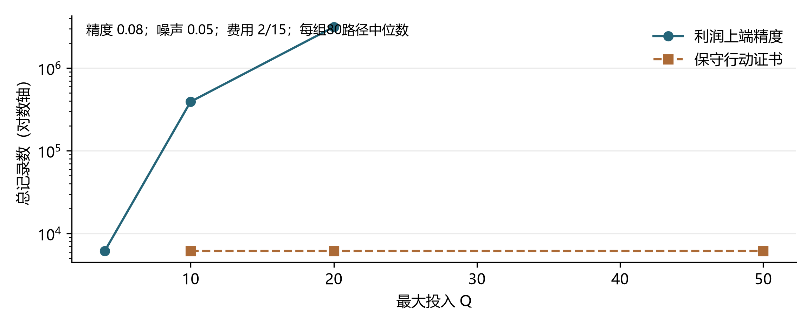
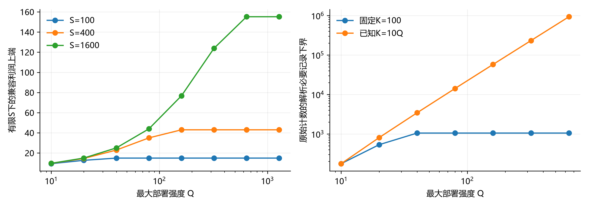

# 有限预算下的机会捕获：利润边界与测量精度

2026年10月15日　应用合同实质修订稿

## 摘要

有限规模的收入测量通常不能唯一恢复机会组成，但仍可能支持可靠的资源配置。本文在固定指数捕获机制、非负有限奖励测度及有界部署强度下，比较两项任务：测准观测兼容的最高可能利润，以及选择接近最佳保守保证的行动。对任意固定数量的等距读数，在严格矩内点和一个开放的低费用区间内，固定绝对金额精度τ的诚实利润上端报告需要Ω(Q²/τ²)条记录，其中Q为最大部署强度；保守行动则存在高概率记录预算不依赖Q的程序。高费用使两项任务局部截短；已知统一总奖励上限时，两项任务在固定部署范围外完全不变。进一步给出已知有限上限下的闭式边界，并在已知K个机会、单次奖励为1、记录严格有界且可在低强度区间任意选点的模型中，证明饱和前仍有平方记录下界。固定K时该下界只限于有限部署区间，与最终截短相容。三个读数给出尖锐利润范围、保守行动和可实施的同时证书。本文区分实际最优利润、兼容利润上端及最佳保守保证，明确必要预算上限与高概率停止预算的不同含义。固定事件佣金和隐私约束下的去重触达作为制度对照，平台事实与额外模型假设逐项区分。合成计算检验边界、费用分区及原始计数证书，不作为真实平台校准或数学证明的替代。

**关键词：** 机会捕获；部分识别；矩约束；保守行动；测量复杂度；有限预算

## 1. 引言

一个团队只测过正常、两倍和三倍搜索强度的平均收入，现在需要决定是否购买更多处理资源。有限读数不能告诉它全部机会是什么，却可以回答两个不同问题：在这些读数允许的市场中，利润最高可能达到多少；以及不知道真实市场时，选什么投入能够保证较好的收益。

本文的主要结论是，这两个问题可能需要截然不同的测量预算。最大允许投入扩大时，最高可能利润仍受“高奖励、低捕获率”的隐藏机会影响；保守行动则可以由一个有限奖励的兼容世界排除过大投入。固定绝对精度下，前者出现关于最大投入的平方记录下界，后者存在不依赖最大投入的记录充分界。

第二项结论确定这种差异的条件。资源费用低于读数允许的极慢机会尾部斜率时，远端机会影响上端；费用高于该斜率时，上端也能截短。若另有可信的统一奖励上限，所有兼容世界的最佳投入都能截短。每个世界的奖励分别有限，不等于事先知道一个对全部世界共同成立的奖励上限。

三个读数的闭式边界是上述比较的可计算实现。为检验观察协议的代表性，本文另处理已知有限奖励上限，并把必要界扩展到连续低强度探测及原始有界计数。本文不把指数捕获、矩极值、极小极大交换或置信集合本身视为新工具；贡献集中在指定观察协议下的具体边界、任务成本分离及其费用和信息分区。全文不要求从三个读数恢复真实机会组成，也不声称少量测量即可获得真实世界的最优行动。

全文安排如下：第2节定义模型与统计目标；第3节给三读数尖锐边界；第4节集中陈述一般有限读数下的成本分离和消失条件；第5节给同时证书；第6节报告合成验证；第7节讨论已有研究与金融解释。附录A至D给出全部核心证明及证书公式。

## 2. 模型、变量与两个统计任务

### 2.1 从捕获机制到收入函数

固定一个经营窗口及交易执行规则。q≥0表示搜索或处理尝试强度相对于基准的倍数，不是交易本金。对某机会，基准有效命中率为λ，机会可用时间为T，令z=λT>0。若有效命中时钟为泊松过程，投入q使速率变为qλ，则在可用时间内零命中的概率是exp(−qz)，至少命中一次的概率为1−exp(−qz)。捕获只支付一次奖励。这个机制要求强度线性改变有效尝试率，且机会可用时间和奖励不随本次强度改变。

对有限机会i，设其非负结算奖励为R_i、累计基准暴露为z_i，则期望收入是Σ_i R_i[1−exp(−qz_i)]。定义奖励测度ν(A)=Σ_{i:z_i∈A}R_i，推广为非负有限测度，得到

\[
P_\nu(q)=\int_{(0,\infty)}(1-e^{-qz})\,\nu(dz),\qquad f_\nu(q)=P_\nu(q)-cq.\tag{1}
\]

Pν是扣除固定执行支出、尚未扣除搜索资源费的期望收入；fν为每窗口期望净收益。ν不是概率分布，ν((0,∞))是全部机会的总奖励。原始分离定理要求每个候选世界的该总量有限，不提供已知统一上限；第4.3至4.5节另行处理已知有限上限，不将其与无上限类混用。期望加总本身不要求不同机会独立；统计记录的噪声条件另行规定。

该响应属于经典Bernstein函数框架的有限测度子类[1]；它比单纯的单调凹性更强。泊松占据模型也产生相同的指数发现核[2]。这些文献支持模型的机制与数学归属，不能证明特定市场必然符合模型。

表1　主要符号及单位

| 符号 | 严格含义 | 单位或范围 |
|---|---|---|
| q，Q | 相对尝试强度及其部署上限 | 无量纲，0≤q≤Q |
| c | 单位强度的每窗口资源费 | 金额/窗口；统计分离取c>0 |
| z | 单类机会的累计基准命中强度λT | 无量纲，z>0 |
| ν | 按z分类的非负奖励测度 | 金额/窗口；每个世界总量有限 |
| Pν，fν | 期望收入、扣资源费后的期望净收益 | 金额/窗口 |
| p_k | 强度k下的准确均值Pν(k) | 金额/窗口，不是一条随机记录 |
| Γν，U_E，V_E | 真实最优利润、兼容利润上端、最佳保守保证 | 金额/窗口 |
| τ，α，β | 绝对金额精度、覆盖失败率、紧致报告失败率 | τ>0，α+β<1 |
| N，N_j | 总记录上限、某阶段每臂累计记录数 | 条数；n臂总数为nN_j |

### 2.2 兼容市场与三个不同的值

先固定n个测试强度1,...,n以及部署上限Q≥n。p=(p_1,...,p_n)为准确平均收入向量；其兼容世界集合定义为

\[
\mathcal C_n(p)=\{\nu\geq0:\ \nu((0,\infty))<\infty,\ P_\nu(k)=p_k,\ k=1,\ldots,n\}.\tag{2}
\]

记逐点收入下、上端为L_n(p,q)=inf_{ν∈C_n(p)}Pν(q)和U_n(p,q)=sup_{ν∈C_n(p)}Pν(q)。定义

\[
\Gamma_\nu(Q,c)=\max_{0\leq q\leq Q} f_\nu(q),\qquad U_E(p,Q,c)=\sup_{\nu\in\mathcal C_n(p)}\Gamma_\nu(Q,c),\tag{3}
\]

\[
V_E(p,Q,c)=\max_{0\leq q\leq Q}\{L_n(p,q)-cq\}.\tag{4}
\]

Γν是某个真实世界的最佳利润；U_E是所有兼容世界中最高可能的最佳利润；V_E是先选一个行动后，对所有兼容世界都成立的最佳保证。不执行q=0始终允许，实际收入与净收益均为0。后文U_E、V_E省略参数时仍保持这些含义。

### 2.3 观察协议与成功标准

每条记录选择一个测试臂k∈{1,...,n}。必要界首先采用独立高斯均值读取Y=Pν(k)+σ_kξ，其中ξ为标准正态，已知σ_k>0；允许根据过去记录自适应选择臂和停止。此代理是均值观测，不将可能为负的高斯记录解释为原始非负交易现金。

利润上端任务要求上报告T对全部合法世界满足Prν(T≥Γν)≥1−α，并在指定内点p_0的基准世界满足Pr(T≤U_E(p_0,Q,c)+τ)≥1−β。后者约束报告不能过松。因为同读数世界产生相同日志分布，对全部世界诚实与上确界逼近共同约束了兼容上端。充分程序直接给覆盖U_E、宽度不超过τ的区间。

保守行动任务要求以至少1−α概率输出q̂，使L_n(p,q̂)−cq̂≥V_E(p,Q,c)−τ。它不是要求fν(q̂)≥Γν−τ。两项任务使用同一批可选测试强度，但目标不同。

必要界中的N是任何允许轨迹上的总记录上限；充分界是共同覆盖事件上的高概率停止预算，程序另有几乎必然终止性。本文不把这两种预算定义混写成无条件的精确最优Θ结论，也不由高概率界直接宣称期望预算同阶。

## 3. 三读数的尖锐利润范围

本节取n=3，Q≥3。令v=1−exp(−z)∈(0,1)，并严格定义推前奖励测度μ(A)=ν({z:1−exp(−z)∈A})。三个读数给出

\[
a=p_1=\int v\,\mu(dv),\quad B=2p_1-p_2=\int v^2\,\mu(dv),\quad D=3p_1-3p_2+p_3=\int v^3\,\mu(dv).\tag{5}
\]

假设严格内点a>B>D>0且aD>B²。概率测度π(dv)=vμ(dv)/a满足Eπv=B/a和Eπv²=D/a。令

\[
r=a-\frac{B^2}{D},\quad s=\frac{D}{B},\quad M_F=\frac{B^3}{D^2},\quad \ell=\frac{B-D}{a-B},\tag{6}
\]

\[
w=\frac{a-B}{1-\ell},\quad m_G=a-w,\quad M_G=\frac{w}{\ell},\quad
F(q)=rq+M_F[1-(1-s)^q],\tag{7}
\]

\[
G(q)=m_G+M_G[1-(1-\ell)^q],\qquad q>0.\tag{8}
\]

**定理1（三读数尖锐边界）。** 对上述内点、全部c≥0及Q≥3，逐点有L_3=min(F,G)、U_3=max(F,G)，并且

\[
V_E=\max_{0\leq q\leq Q}[\min(F(q),G(q))-cq]=\inf_{\nu\in\mathcal C_3(p)}\Gamma_\nu,\tag{9}
\]

\[
U_E=\max\{0,\sup_{0<q\leq Q}[\max(F(q),G(q))-cq]\}.\tag{10}
\]

式(9)在0以实际收益0延伸。端点可以由合法、有限奖励的世界任意逼近。G在q趋0时可能有正右极限；这是越来越快机会的极限，不是零投入可以收取收入。F/G的上下位置随q区间切换，不能把F始终称为下界、G始终称为上界。

证明将读数变成两个概率矩，利用经典端点插值和主表示理论求逐点界[3,4]，再用严格有限节点逼近保证合法性；收益下端的同一世界性质使用Sion定理[5]。附录A给出完整计算。V_E只须比较0、1、2、3、Q及相应分支的内部峰，无须恢复ν。

作为信息基准，若只知道响应非负、单调、凹、全域有界且通过同样三个读数，则最佳保守保证为max{0,p_1−c,p_2−2c,p_3−3c}。同一例子下，捕获结构能严格收紧范围；较小Q或其他费用时不保证严格改善。

表2　同读数、同费用、同部署上限的准确比较

| 信息条件 | 最佳保守保证 | 最佳保守投入 | 兼容利润上端 |
|---|---|---|---|
| 仅单调凹性 | 0.516000 | 3.000000 | 1.048000 |
| 固定机会捕获结构 | 0.546604 | 4.309769 | 0.777731 |

表2取p=(0.4,0.64,0.816)、c=0.1、Q=10。保证提高约5.93%是条件模型中的金额比较，不是实际交易收益提升的实证。Q=3、c=0.1时两个保证均为0.516。

图1　有限部署范围内的利润边界与保守行动。曲线由指定合成读数计算，端点解释遵循定理1。

## 4. 主要结果：测量成本分离与费用分区

### 4.1 任意固定数量等距读数

固定n≥2。读数p_0位于严格Hausdorff矩内点，即其变换后的概率矩位于[0,1]截断矩空间的内部。附录D.1给出矩阵判据与端点公式。严格定义r_n(p)=lim_{q→∞}U_n(p,q)/q；附录D.1证明该极限存在，且严格内点下r_n(p)>0。它是兼容上包络的尾部斜率，而非某个有限奖励世界自身的无穷远斜率。其准确上端在q≥n时具有形式F_n(p,q)=r_n(p)q+有界项。三读数时r_3=r。

**定理2（开放低费用区间的任务成本分离）。** 固定n、严格内点p_0、正费用0<c<r_n(p_0)、已知正噪声标准差和满足α+β<1的错误水平。每个兼容世界的总奖励有限，但无已知统一奖励上限。对充分大的Q，任何满足第2.3节标准、总记录数至多N的自适应高斯报告程序均有

\[
N\geq\frac{4\sigma_{\min}^2(1-\alpha-\beta)^2D_Q^2}{\tau^2 C_0^2},\quad
D_Q=aQ-F_n(p_0,Q),\quad C_0=\max_{1\leq k\leq n}|ak-p_{0k}|.\tag{11}
\]

这里a=p_{01}，σ_min=min_kσ_k；当固定τ>0而Q增大时，D_Q=(a−r_n)Q+O(1)，故必要记录数为Ω(Q²/τ²)。同一p_0、c、n及观察协议下，近最优保守行动存在几乎必然终止的程序，其高概率记录充分预算可以不依赖Q。

充分程序适用于已知条件次高斯尾界且条件均值稳定的记录。固定内点及费用后，其预算为τ的平方倒数乘覆盖对数和迭代对数，另计内点验证成本。一个独立的有界二值均值读取实验也具有同样Q平方必要幂次，详见附录D.2。二值实验不自动等价于金融现金原始记录。

该结论允许测试臂自适应选择，但只允许在给定n个规模取得均值记录。若允许免费观察机会组成，或让测试规模随Q扩大，需重新定义统计任务。n固定、τ为绝对金额误差、c和内点固定，都是结论的范围。

### 4.2 为什么两个任务不同

必要界把少量概率质量移向极慢机会。测试强度1,...,n下的平均收入只改变一个小量，但最大部署Q的兼容利润改变约Q倍该小量。严格有限机会世界可以精确匹配改变后的读数并逼近这一利润，因此任何诚实上报告都必须分辨这些相近日志。

行动侧不需要排除所有高利润可能世界。只要读数附近有一个总奖励统一有限的兼容世界，它就足以使过大投入的最坏收益低于不执行。因此最佳保守行动可限制在固定区间，局部均值误差和网格误差也可以用不依赖Q的常数控制。

两项任务要求不同，这是成本分离的含义；本文不声称在相同真实最优目标下无条件减少测量。原始记录的经济价格、测量收入回流和启动现金不是本定理的预算变量。

### 4.3 分离何时消失

**定理3（高费用与已知奖励上限）。** 在定理2的严格内点及固定观察协议下，若c>r_n(p_0)，则存在p_0邻域和与Q无关的R，使该邻域内的利润上端和最佳保守行动均可限制在[0,min(Q,R)]；固定精度记录充分预算可以不依赖Q。若c=r_n，只有在F_n(Q)−cQ控制全局上端时继承必要界，不能自动沿用低费用结论。

若另外已知每个兼容世界均满足ν((0,∞))≤M_*且c>0，则所有世界的真实最优利润、兼容上端和保守行动都可限制在[0,min(Q,M_*/c)]。超过该阈值后两个统计目标本身不再随Q改变。必须重新计算带质量约束的兼容边界，不能继续把无质量约束的F/G当作准确界。

表3　固定内点、固定有限观察规模下的分区

| 条件 | 利润上端报告 | 保守行动 |
|---|---|---|
| 0<c<r_n，无统一奖励上限 | 固定金额精度需Ω(Q²/τ²)记录 | 高概率充分预算可不依赖Q |
| c=r_n | 需检查是否由尾部控制上端 | 固定正费用下可截短 |
| c>r_n | 局部截短，充分预算可不依赖Q | 可截短 |
| 已知共同M_*，c>0 | 目标截至M_*/c | 目标同样截短 |

高费用结论是固定p_0附近的局部结论，常数在c趋近r_n时可能发散。已知奖励上限的结论则对加入该约束的兼容集合直接成立，不依赖对无约束集合的尾部近似。

### 4.4 已知有限上限下的准确边界

现在固定已知S，使兼容世界同时满足ν((0,∞))≤S，记集合为C_{3,S}(p)，相应值记为U_E^S、V_E^S。仍取三读数严格内点，定义

\[
T(p)=a+\frac{(a-B)^2}{B-D},\quad
\eta_S=\frac{SD-aB}{SB-a^2},\quad \zeta_S=\frac{aD-B^2}{SB-a^2},\quad
x_\pm=\frac{\eta_S\pm\sqrt{\eta_S^2-4\zeta_S}}2.\tag{12}
\]

当S>T(p)时，0<x_-<x_+<1。令w_+=(a−Sx_-)/(x_+−x_-)、w_-=S−w_+，定义

\[
H_S(p,q)=w_-[1-(1-x_-)^q]+w_+[1-(1-x_+)^q].\tag{13}
\]

**定理4（有限已知奖励上限的尖锐边界）。** S>T(p)时，C_{3,S}(p)非空；在定理1的全部公式中把F换为H_S，即得到该受限集合的准确逐点上下端、U_E^S和V_E^S。H_S对应总奖励恰为S的合法双原子世界；G作为另一个端点仍可由总奖励不超过S的严格合法世界逼近。S≤T(p)的边界或不可行情形不纳入此公式的严格内点陈述。

这一步不是把无上限F/G硬截到S。新增质量约束改变了极值世界，必须重新求解四个奖励矩。附录E.1用三次Hermite插值证明，G及H_S的上下方向仍在1、2、3切换。固定p与q时，S增大使H_S趋向F；固定S时H_S饱和，所以定理3的远端截短仍成立。

### 4.5 有限机会池与任意低强度探测

为了检验“只有几个均值、无统一奖励上限”是否是困难的唯一来源，考虑更强的已知信息：每个窗口恰有已知整数K个机会，每次捕获只得1单位奖励，故实际收入Y∈{0,...,K}且总奖励上限恰为K。固定整数m≥1、z_0>0、ρ>c>0，其中m个机会的捕获速度为z_0，其他K−m个为ρ(1+ε)/K，未知参数ε位于一个小非负区间。ρ是本节的构造参数，有限K时不等于读数尾部斜率r_3(p)，该斜率在K增大时趋于ρ。其均值与原始记录是

\[
P_{K,\varepsilon}(q)=(K-m)[1-e^{-q\rho(1+\varepsilon)/K}]+m[1-e^{-qz_0}],\tag{14}
\]

\[
Y(q)=Y_s(q)+Y_f(q),\quad
Y_s\sim\mathrm{Bin}(K-m,1-e^{-q\rho(1+\varepsilon)/K}),\quad
Y_f\sim\mathrm{Bin}(m,1-e^{-qz_0}).\tag{15}
\]

两项及不同窗口独立。算法可以根据过去记录，在任何q∈[0,q_p]探测；固定q_p≥3，不再限于三个档位。它只得到去重捕获总数；即使额外揭示两个群体的全部首次捕获二元指示（不含时间或重复消息），下述信息下界仍成立。允许的最终部署仍为[0,Q]，其中Q可大于q_p。

**定理5（有界原始计数与连续探测的有限尺度下界）。** 固定上述常数及α+β<1。存在κ、Q_0、K_0和正C，使K≥K_0、Q_0≤Q≤K/κ时，任何总记录数至多N、对该单位奖励家族诚实的最优利润上报告，若在ε=0以至少1−β概率不超过其真实最优利润加τ，则对固定小精度0<τ≤τ_0有N≥C Q²/τ²。可取任意满足ρ exp(−ρ/κ)>c的κ，再适当增大Q_0、K_0。基准真实最优利润同时等于三读数及奖励上限K支持的U_E^K。

该下界允许连续、自适应选择低强度，使用真实有界计数，没有高斯均值代理、单笔无界奖励或未知总奖励上限。它证明有限K下的困难区间，不是在固定K时让Q无穷增长。Q超过K/c后目标不再改变；本定理与该截短完全相容。

对这些任务，三读数位于统一的严格内点邻域，且K足够大。以宽类C_{3,K}(p)定义的V_E^K仍有记录预算不依赖Q、K的保守行动程序，利用方差随均值控制的计数集中界即可实现。这里的保证目标仍是该宽类的最佳保守值；不声称接近已知两速率模板下的真实最佳行动，也不声称解决只含整数单位奖励世界时的最优保守值。附录E.2至E.4证明必要界和证书。

## 5. 三臂可实施证书与精度预算

**定理6（同时证书）。** 三读数严格内点、独立等方差高斯均值记录下，只输入Q、c、σ、α、τ，即可构造两种程序：其一输出覆盖U_E的区间并在宽度≤τ时停止；其二输出行动及保证，并在其与V_E的证书差距≤τ时停止。两者均几乎必然终止，共同覆盖事件概率至少1−α。第二种程序要求c>0。

具体程序在阶段j为每臂累计N_j=32·2^(j−1)条记录，构造半宽e_j=σ sqrt(2 log[6j(j+1)/α]/N_j)的同时均值盒。盒及节点比例检查未通过时继续取样。通过后，中心读数决定Hermite多项式；其线性系数误差由整个盒同时保护，所以方向可以依赖同一数据。连续行动网格余量显式计入证书。附录C.1至C.4给出上下证书、停止条件和全部区间计算。

令K_Q为安全内点邻域中的Hermite原均值系数一范数上界，δ_K为验证该邻域所需的半径。存在K_Q≤C_K(1+Q)，上端程序的高概率总记录预算为

\[
O\!\left(1+\sigma^2\max\{K_Q^2/\tau^2,\delta_K^{-2}\}\left[\log(1/\alpha)+\log\log(3+\sigma K_Q/\tau+\sigma/\delta_K)\right]\right).\tag{16}
\]

该式保留了迭代对数中的Q依赖。行动程序利用有限奖励见证截短，相关常数可不依赖Q。必要界与充分界给出相同平方幂次的机制证据，但仍有对数、局部常数以及预算定义差异，不构成最优常数或最佳臂分配的证明。

附录B.1进一步优化局部替代方向。若上端由F(p_0,Q)−cQ控制，b_Q=∇_p F(p_0,Q)，则

\[
\liminf_{\tau\downarrow0}\tau^2N(\tau)\geq4(1-\alpha-\beta)^2\left(\sum_k\sigma_k|b_{Qk}|\right)^2.\tag{17}
\]

b_Q=Q∇r+O(1)，使上端精度与费用分界r的敏感性相连。阶段置信球、旋转外盒和独立先导可改善实现常数；这些是既有置信集合与样本拆分工具的应用，不是额外的通用统计创新[6,7]。

## 6. 合成验证与可复现计算

全部案例均为合成数据。表4使用p=(0.4,0.64,0.816)、σ=0.05、α=0.05、τ=0.08、c=2/15；该费用处于本例临界点，已单独检查尾部控制上端。一般低费用区间另外由n=2至7的矩规则和替代世界验证覆盖。

表4　原盒程序的总记录中位数

| 最大部署Q | 上端程序，80条路径/组 | 行动程序，80条路径/组 |
|---|---|---|
| 4 | 6144 | 未运行 |
| 10 | 393216 | 6144 |
| 20 | 3145728 | 6144 |
| 50 | 未运行 | 6144 |

三组上端路径的共同覆盖事件失败1次；共同事件内未发现区间违规。三组行动路径共同事件内未发现保证违规。不同Q的行动程序使用相同随机种子，不能视作组间独立检验。未运行不是零记录成本。

图2　上端与行动证书的合成记录成本。有限点上的运行差异用于核查实现，不用于替代渐近必要界。

表5　上端证书实现的常数改进，40条路径/组

| Q | 原盒程序 | 同阶段球程序 | 先导加全新验证 |
|---|---|---|---|
| 10 | 393216 | 196608 | 74245.5 |
| 20 | 3145728 | 786432 | 465852 |

先导每臂2048条，全部计入总数；是否停止仍由新验证证书决定。前两程序使用配对路径，先导程序另用新路径。球程序两个Q组各有2次共同覆盖事件失败；事件内未发现证书失效。样本中位数可以为半整数，因为路径数为偶数。局部必要下界约4523条与运行中位数不是同一种保证，不能将其比值称为算法最优性差距。

独立计算包括14项离散矩线性规划、315项凹性线性规划、上下Hermite核各273项、720项盒内不同真实均值证书检查。一般n验证包括36组矩规则、108项低费用替代比较、3项带共同奖励上限的线性规划、6项二值实验KL比较，以及40条历史相关、条件均值固定的有界噪声路径。矩线性规划是离散近似，不能认证连续测度尖锐性；网格检验也不能认证全域核不等式。概率保证与尖锐性由附录证明承担。

复现包保存固定随机种子、脚本、归档结果和依赖说明。主文的统计数量来自归档实验，发布前另在隔离目录重跑对应程序并核对结果；运行耗时因机器而异，不列为主贡献。

### 6.1 已知上限与原始有界计数的新增验证

有限S公式由288项独立离散线性规划对照，最大差为5.06×10^-7；三个奖励矩的最大残差小于10^-13。三次插值的符号和常数项另做网格核查，连续结论以附录E.1证明为准。

单位奖励家族取ρ=1.4、m=8、z_0=0.9、c=0.8、q_p=3。上端报告与行动证书均取绝对精度0.5。固定K=100时，上端及相邻替代世界的检验预算最终饱和；令已知K=10Q时，使用对整个[0,3]有效的解析KL上界得到平方必要成本。最后四个尺度的对数斜率约2.0，仅作有限尺度诊断，不作为新定律的拟合证明。基准读数随K变化；同一固定K的Q扫描保持读数不变。

图3　有限奖励限制与饱和前困难。左图使用固定p=(4,6.4,8.16)的受限利润上端；右图使用定理5的单位奖励家族，故两图不是同一组读数。右图为解析KL不等式给出的必要记录下界，不是算法实际耗费。固定K与K=10Q分别展示最终饱和及饱和前的平方增长。

原始计数验证按两项二项分布生成独立窗口记录，累计统计量仍与逐窗采样具有相同分布，且每条记录严格在[0,K]。对三个K、两个Q及未知参数ε∈{0,0.05,0.1}的18组任务，各运行400条独立路径，实际执行计数区间、合法性检查、行动选择和停止。联合成功要求所有已使用区间覆盖真实均值、有限停止及所选行动相对V_E^K的损失不超过0.5。预算以总窗口记录数计，不是现金存活或支付能力。

表6　原始有界计数的完整推断与行动

| 已知K | 最大部署Q | 总记录中位数 | 联合成功 |
|---|---|---|---|
| 100 | 20 | 393216 | 1200/1200 |
| 100 | 80 | 393216 | 1200/1200 |
| 400 | 20 | 393216 | 1200/1200 |
| 400 | 80 | 393216 | 1200/1200 |
| 1600 | 20 | 393216 | 1200/1200 |
| 1600 | 80 | 393216 | 1200/1200 |

7200条路径全部满足联合标准；对18组同时作单侧95% Clopper–Pearson校正，组成功率的下界均约0.985。表6按K、Q合并三个参数值，每行1200条；校正按未合并的18组计算。另有78个可行均值盒、3120个盒内真实点，将证书与全部四段的准确保守最优值交叉检查，未发现违反。经验结果不替代名义至少0.95的证明。记录数仍较大，不能据此声称小样本经济可行；该案例检验的是已知有限池、原始有界计数及Q无关停止的可实现性。附录E.4用解析导数区间和曲率认证行动损失，没有用数值优化器的输出充当全区间证书。

[原始计数复现程序](复现代码/experiments/application_contract_bridge.py)及对应JSON已纳入复现附件；数据均为合成，平台文档仅用于下面的制度映射。

**代码与数据可用性。** 随论文提供本地复现附件：[复现入口与结果索引](复现代码/README.md)、[完整运行说明](复现说明.md)、[一键运行程序](复现代码/复现.py)和[独立复现包](复现代码与结果.zip)。这些相对链接需与附件保持目录结构。目前未配置公开代码仓库或DOI；附件包含七组实验源码、固定种子、合成结果、图表程序及核验记录。

## 7. 文献归属、金融解释与局限

### 7.1 结果相对已有工具的位置

矩空间主表示和端点求积已提供固定矩下的积分极值结构[3,4]；本文的F/G是其在收入读数中的闭式实现。Sion定理负责同世界下端交换[5]，并非新的极小极大工具。分布鲁棒优化与置信集合驱动的决策已有系统研究[6,8]，本文具体化为三臂证书及部署范围截短。

Donoho用目标泛函的连续性模量刻画间接观察的估计困难[9]；Smart Predict-then-Optimize强调预测误差与决策损失的区别[10]。本文不主张首次发现“不同目标需要不同精度”，而是证明指定机会机制和观察协议中Q平方必要成本、Q无关行动充分成本及r_n费用分区。

未见物种预测研究从有限样本推断增加采样后的新发现，并给出外推范围的最优限制[11]。它与隐藏慢机会的机制接近，但通常观察物种频数信息，目标和误差标准也不同；本文只读固定规模的收入均值。两者的具体定理是否可相互归约仍需进一步核查，不能仅凭对象名称不同认定原创。

交易策略容量实验研究规模干预、有限部署水平识别与共同市场背景[12]。本文固定捕获机制，研究这些均值允许的非参数利润范围及其测量负担，不替代竞争均衡或价格冲击模型。本文不作“首次”或穷尽近邻的声明。

### 7.2 重要应用的制度映射与可证伪条件

本文不再以“普通套利市场天然只提供三个均值且没有总奖励上限”作为主要适用性理由。更具体的对照是隐私约束下的去重触达或固定价值的新客户覆盖：每个对象在窗口内只计一次价值，增加资源提高触达概率，内部标识可能不向决策方发布。Ads Data Hub文档说明结果按用户组聚合，底层数据不能直接检查[14]。隐私检查还涉及访问预算、噪声与过滤[15]；这些事实支持聚合信息的重要性，不证明平台只释放均值。

广告实验提供预算或流量分配机制[16]，但同一流量比例不保证相同比例的支出或曝光，不能直接把花费当成q。更合适的q是固定投放与人群规则下、经日志校准的有效接触强度；每个首次有效触达按预先指定的单位价值计数。总人口或客户数已知时，可以直接使用有限S结果。未知目标人群量不等于物理世界无限，也不应掩盖已有的粗上限。

固定事件佣金提供更直接的货币载体。Amazon Associates规则规定合格Bounty事件的结算、重复或不合格事件的排除，并列出事件费率[18]；报告界面可按Tracking ID查看佣金与Bounty汇总[19]。这支持“每个合格事件支付约定奖励、决策方可得到分组收入”的对应，不证明只存在均值信息或命中率线性。应固定同类事件、结算规则与归因窗口，将未合格及撤销事件纳入统计，另审计获客强度与收益曲线。本文没有实际参加该计划或检验其真实数据。

去重触达本身首先是覆盖效用；若没有结算合同，不能把每次触达直接当作真实利润。解释为货币收益还需要验证预先指定的增量价值。已有可审计结算上限时应使用S约束，而不是以目标人群未知为由删除它。

表7　有来源的应用联系与仍需核验的条件

| 要素 | 可核查的制度或模型对应 | 适用限制与失败信号 |
|---|---|---|
| 聚合反馈 | 隐私测量可发布群体汇总，阻止直接检查底层用户[14,15] | 频数、群体细分等额外渠道可能存在，必须列入实际信息集合 |
| 可控试验 | 平台实验可分配预算或流量[16] | 用实测有效曝光定义q；若改变人群或竞价，不能套用固定响应 |
| 一次价值 | 去重覆盖是已有测量任务[17]；合格事件可有约定佣金[18,19] | 普通触达不等于利润；重复收益、撤销和归因须审计 |
| 有限奖励池 | 已知人数及每人价值上限给S | 使用定理4与固定K有限区间，不沿用无上限的固定类渐近结论 |
| 原始噪声 | 独立但成功率不同的Bernoulli之和给有界计数；定理5是双群体特例 | 对象相关、跨窗记忆、隐私过滤与额外噪声须另验证或纳入证书 |
| 低强度试点 | 项目须提供限制试点强度的预算、配额或试验容量依据 | 下界依赖固定q_p；若可直接试验接近Q的强度，应重新计算信息量 |

这是一个有文档支撑的候选应用及可实施实验设计，不是对某个平台的现成统计保证。应先固定目标人群、窗口、价值规则和执行方式，再交错随机分配若干强度；用未参与拟合的强度检验单调性、饱和形状及跨时段稳定性。记录全部配置与未触达对象的分母。若观察到人群迁移、明显非泊松命中、窗口依赖或预测不覆盖，应拒绝当前机制。此处未运行真实广告、访问用户数据或校准实际市场。

隐私文档中的过滤不应当被当作零收入。已知、与隐藏参数无关的计数后处理不能增加区分能力，因此信息必要界可用数据处理不等式保留；但充分证书必须加入已知噪声或删失误差。平台完整流程是否是该后处理，仍需单独审计。

套利扫描仍是另一个可能载体：固定路由、交易量规则、报价及提交方式，只改变搜索吞吐。若q同时改变滑点、竞价或竞争行为，模型不再成立；现有DEX研究显示这些机制可以联动[13]。本文因此不将套利视作已经验证的代表性实例。

若未来H个稳定窗口的固定支出F_start大于H U_E或相应受限上端，可否决仅靠这些执行收益回收支出的方案。实际购买测量仍须计入价格、期限与测试收入；本文不提供一般启动现金或融资结论。比例曲线Mq/(q+X)是模型子类，但其两参数识别与外样本验证不属于本次已完成的结果。

### 7.3 适用范围

原始定理依赖非负奖励、固定响应、稳定均值、固定有限测试规模及内点条件；定理4、5分别放松无统一上限和固定档位/高斯代理的限制，但仍要求低强度试验范围及指定命中机制。费用趋零、趋费用分界或读数趋矩边界时，常数可能恶化。高阶矩计算的数值条件和运算复杂度未获统一最优保证。不存在真实平台或市场校准，也未处理任意漂移、任意竞争反应、完整隐私发布流程或一般最优测量融资。定理5允许任意低强度选点，但不等于所有非等距矩边界或任意观察渠道的完整分区。有限合成验证不构成外部同行认证。

## 8. 结论

有限规模收入信息能够支持尖锐利润范围，却不唯一确定真实市场。本文的核心结果是，在同一捕获机制、固定有限测试规模和正费用下，报告兼容最高利润与取得近最优保守行动具有不同的测量成本；这种分离的出现与消失由慢机会尾部、资源费用及共同奖励信息共同决定。三个读数使该比较可闭式计算并用同时证书实施。有限奖励池扩展表明，困难可在已知上限、单位奖励、原始有界计数和连续低强度探测下保留一个饱和前区间；它不要求真实应用具有无限奖励池。

## 参考文献

[1] Schilling, R. L., Song, R., and Vondraček, Z. (2012). Bernstein Functions: Theory and Applications, 2nd ed. De Gruyter. DOI: 10.1515/9783110269338.

[2] Gnedin, A., Hansen, B., and Pitman, J. (2007). Notes on the occupancy problem with infinitely many boxes: General asymptotics and power laws. Probability Surveys 4, 146–171. DOI: 10.1214/07-PS092. https://arxiv.org/abs/math/0701718.

[3] Dette, H., and Schorning, K. (2013). Complete classes of designs for nonlinear regression models and principal representations of moment spaces. Annals of Statistics 41(3), 1260–1267. DOI: 10.1214/13-AOS1108. https://arxiv.org/abs/1306.4872.

[4] Gautschi, W. (1981). A Survey of Gauss-Christoffel Quadrature Formulae. In E. B. Christoffel: The Influence of His Work on Mathematics and the Physical Sciences. Author reprint: https://www.cs.purdue.edu/homes/wxg/selected_works/section_12/074.pdf.

[5] Sion, M. (1958). On general minimax theorems. Pacific Journal of Mathematics 8(1), 171–176. DOI: 10.2140/pjm.1958.8.171.

[6] Bertsimas, D., Gupta, V., and Kallus, N. (2018). Data-driven robust optimization. Mathematical Programming 167, 235–292. DOI: 10.1007/s10107-017-1125-8.

[7] Chugg, B., Wang, H., and Ramdas, A. (2024). Time-Uniform Confidence Spheres for Means of Random Vectors. Author version: https://arxiv.org/abs/2311.08168.

[8] Delage, E., and Ye, Y. (2010). Distributionally Robust Optimization under Moment Uncertainty with Application to Data-Driven Problems. Operations Research 58(3), 595–612. DOI: 10.1287/opre.1090.0741.

[9] Donoho, D. L. (1994). Statistical Estimation and Optimal Recovery. Annals of Statistics 22(1), 238–270. DOI: 10.1214/aos/1176325367.

[10] Elmachtoub, A. N., and Grigas, P. (2022). Smart “Predict, then Optimize”. Management Science 68(1), 9–26. DOI: 10.1287/mnsc.2020.3922. https://arxiv.org/abs/1710.08005.

[11] Orlitsky, A., Suresh, A. T., and Wu, Y. (2016). Optimal prediction of the number of unseen species. PNAS 113(47), 13283–13288. DOI: 10.1073/pnas.1607774113. https://arxiv.org/abs/1511.07428.

[12] Rodríguez Domínguez, A., and Noguer i Alonso, M. (2026). Robustness or Crowding: Experimental Design for Trading Strategy Capacity. Author manuscript: https://arxiv.org/abs/2608.08405.

[13] He, X. D., Yang, C., and Zhou, Y. (2025). Arbitrage on Decentralized Exchanges. Author manuscript: https://arxiv.org/abs/2507.08302.

[14] Google. Ads Data Hub: Introduction and product overview. Official documentation, accessed 2026-10-15. https://developers.google.com/ads-data-hub/guides/intro ; https://developers.google.com/ads-data-hub/ .

[15] Google. Privacy checks in Ads Data Hub. Official documentation, accessed 2026-10-15. https://developers.google.com/ads-data-hub/guides/privacy-checks .

[16] Google. Experiments FAQs. Official documentation, accessed 2026-10-15. https://support.google.com/google-ads/answer/13826584?hl=en .

[17] Wright, C. W., et al. (2021). Privacy-centric Cross-publisher Reach and Frequency Estimation Via Vector of Counts. Google Research. https://research.google/pubs/privacy-centric-cross-publisher-reach-and-frequency-estimation-via-vector-of-counts/ .

[18] Amazon. Associates Program Policies, Commission Income Statement §§4–6 and fee appendix. Official documentation, accessed 2026-10-15. https://affiliate-program.amazon.com/help/operating/policies ; https://affiliate-program.amazon.com/help/node/topic/GRXPHT8U84RAYDXZ .

[19] Amazon. How To use reports. Official documentation, accessed 2026-10-15. https://affiliate-program.amazon.com/help/node/topic/GMWAK55DQX8JEK7C .

---

# 附录：完整证明与证书细节

本附录沿用R1至R4作为证明索引：R1对应定理1；R2/R2b给三臂必要界及局部方向；R3/R3b/R3c对应定理6；R4对应定理2、定理3及一般行动截短。附录E证明定理4、定理5及原始计数行动证书。附录各自的章节编号仅用于定位证明。

## 附录记号：三臂对象

资源基准归一化为1，行动为q∈[0,Q]，Q≥3，单位资源费用c≥0。机会响应

\[
P_\nu(q)=\int_{(0,\infty)}(1-e^{-qz})\nu(dz)\tag{18}
\]

其中ν是非负、有限奖励测度。所有候选世界共享观测p=(P(1),P(2),P(3))。每个世界P(0)=0。定义

\[
a=p_1,\quad B=2p_1-p_2,\quad D=3p_1-3p_2+p_3.\tag{19}
\]

三臂结果取严格内点a>B>D>0、aD>B²。令

\[
r=a-B^2/D,\quad s=D/B,\quad M_F=B^3/D^2,\tag{20}
\]

\[
\ell=(B-D)/(a-B),\quad w=(a-B)/(1-\ell),\quad M_G=w/\ell,\quad m_G=a-w.\tag{21}
\]

两条边界为

\[
F(q)=rq+M_F[1-(1-s)^q],\qquad G(q)=m_G+M_G[1-(1-\ell)^q],\quad q>0.\tag{22}
\]

U(q)=max(F,G)、L(q)=min(F,G)。仅用于计算上确界时将U(0+)记为m_G；实际行动q=0收益为0，L连续延伸L(0)=0。定义真实世界最优净收益Γν=max_{q∈[0,Q]}(Pν(q)-cq)，信息支持的上限U_E=supνΓν，最优保守保证V_E=max_q infν(Pν(q)-cq)。Γν与U_E不可互换。

## A. 三读数尖锐范围（R1）

\[
U_E(Q,c)=\max\{0,\sup_{0<q\le Q}[U(q)-cq]\},\tag{A.1}
\]

\[
\inf_\nu\Gamma_\nu=V_E(Q,c)=\max_{0\le q\le Q}[L(q)-cq].\tag{A.2}
\]

这些式子适用于所有c≥0；高费用时保留不执行0。所谓准确包括上、下端可由严格合法世界达到或任意逼近，端点世界不要求本身合法。

**证明：逐点界。** 置v=1−exp(−z)，令μ为ν在该变换下的推前奖励测度、π(dv)=vμ(dv)/a，则π在(0,1)，Eπv=B/a、Eπv²=D/a。核g_q(v)=[1-(1-v)^q]/v，g_q(0)=q、g_q(1)=1。其三阶导符号是−sign[(q−1)(q−2)(q−3)]。在0处简单节点、s处重节点的二次插值，以及ell处重节点、1处简单节点的二次插值，其余项分别含v(v−s)²及(v−ell)²(v−1)。因而F上界的区间为[1,2]及[3,∞)，G在其余q>0区间为上界。三个整数节点相等。极限端点分布分别为

\[
\pi_F=(r/a)\delta_0+(1-r/a)\delta_s,\qquad \pi_G=(w/a)\delta_\ell+(m_G/a)\delta_1.\tag{A.3}
\]

左端逼近取ε>0、sε=(D/a-(B/a)ε)/(B/a-ε)，解概率均值权重；右端取h=1−ε、ellε=[(B/a)h-D/a]/[h-B/a]，再解均值权重。ε充分小时节点和权重均严格合法，两个矩严格不变。每个奖励测度质量为a乘概率权重除节点，逐个有限。对任意固定q>0响应趋于对应边界，证明上下逐点尖锐。上端supνsupq可以交换，因此得到U_E的准确公式，包括q↓0的上确界。

**证明：同一世界的下端。** 候选ν集合凸，赋有限测度对有界连续测试函数的弱拓扑。固定q，Pν(q)−cq对ν连续仿射；固定严格ν，对q连续凹。行动区间[0,Q]凸紧致，因此Sion单边紧致推论给max_q infν=infν max_q。候选ν无须紧致，也未纳入无限质量的端点世界。逐点下界和L(0)=0给显示公式，紧致行动保证最大值存在。inf定义给任意精度下的合法同世界逼近。这一步是既有Sion定理的应用。

**有限计算。** F−cq、G−cq各为凹函数；导数分别是r+M_F z_F exp(−z_F q)−c与M_G z_G exp(−z_G q)−c，z_F=−log(1−s)、z_G=−log(1−ell)。各自内部峰在导数零点，截到[0,Q]。U_E比较两峰与0。V_E比较0、1、2、3、Q以及位于相应下界分支的两峰；只需有限个值。

### A.1 同观测的一般凹性基准

基准类是非负、连续、非减、凹且全域有界的曲线P，P(0)=0，共享三读数。不要求固定捕获表示。记Δ2=p2−p1、Δ3=p3−p2，则0<Δ3<Δ2<p1。其逐点准确上界为

\[
U_C(q)=\begin{cases}p_1-\Delta_2(1-q),&0<q<1,\\ \min\{p_1q,p_2-\Delta_3(2-q)\},&1\le q\le2,\\ \min\{p_2+\Delta_2(q-2),p_3\},&2\le q\le3,\\ p_3+\Delta_3(q-3),&3\le q\le Q.\end{cases}\tag{A.4}
\]

证明由相邻割线斜率非增：在(0,1)，(p1−P(q))/(1−q)≥Δ2；[1,2]同时用原点割线与[2,3]斜率；[2,3]同时用[1,2]斜率和非减；q≥3用[2,3]斜率。逐个目标点按取到的数值作分段直线，经0、目标点、1、2、3（按位置排序），斜率非负非增；延伸至Q后取常数。q→0的正上极限用更短陡峭首段逼近。因此基准类即使要求每个世界全域有限也尖锐。

逐点下界是经过0、1、2、3的直线弦，其后常数；这条同一曲线本身合法且逐点最小。所以

\[
V_C=\max\{0,p_1-c,p_2-2c,p_3-3c\},\quad \overline{\Gamma}_C=\max\{0,\sup_{0<q\le Q}[U_C(q)-cq]\}.\tag{A.5}
\]

上端只须查0右极限、1、2、3、Q，以及两内部折点(p2−2Δ3)/(p1−Δ3)和2+Δ3/Δ2。V_E≥V_C、U_E≤上式，但严格改善须用实际读数及费用判断，非普遍严格。

## B. 三臂报告必要预算（R2）

固定上述内点读数p0，c=r0。假设Q≥3满足可直接计算的条件U0=U_E(p0,Q,c)=F0(Q)−cQ。令

\[
D_Q=aQ-F_0(Q)>0,\quad C_0=\max_{k=1,2,3}|ak-p_{0k}|.\tag{B.1}
\]

允许测量自适应选择k∈{1,2,3}，每次记录独立N(Pν(k),σ_k²)，已知σ_k≥σmin>0。任何政策总记录数至多N，内部随机化与世界无关。上报告T覆盖每个严格合法世界的真实Γν，概率至少1−α；在某个拥有p0的基准世界，Pr(T≤U0+τ)≥1−β。若α+β<1、0<τ<D_Q，则

\[
N\ge \frac{4\sigma_{\min}^2(1-\alpha-\beta)^2 D_Q^2}{\tau^2C_0^2}.\tag{B.2}
\]

**证明。** 闭包概率πε=(1−ε)π0+εδ0的对应读数pεk=(1−ε)p0k+εak，a不变。这仍是严格内点矩（对ε<1），其左端规则恰为(1−ε)πF0+εδ0：非零节点s不变，剩余零节点质量增加。因此Fε(q)=(1−ε)F0(q)+εaq，U_E(pε,Q,c)≥U0+εD_Q。若ε>τ/D_Q，可用前述严格同矩有限世界逼近选出Γν>U0+τ；诚实性要求在pε日志分布下Pr(T>U0+τ)≥1−α。同一pε的严格世界虽然真实利润不同，但本观察协议只依赖三个均值，所以日志分布相同。

基准事件T≤U0+τ的概率≥1−β，故两日志分布总变差≥1−α−β。自适应高斯链式KL至多Nε²C0²/(2σmin²)，停止后可填充零信息标记；Pinsker给总变差≤εC0 sqrt(N)/(2σmin)。令ε从上方趋τ/D_Q，即得界。

**意义与条件。** 当Q大到上端由F尾部控制，D_Q=a(1−r/a)Q−M_F+o(1)，因此固定绝对金额精度τ的必要预算随Q²/τ²增长。这是明确临界费用族的结论；不外推所有费用、所有记录协议。Q有限时始终可以给有限金额上界，本文仅研究有限部署范围，不依赖无限行动域的无穷报告困难。R2研究把信息上端报告得紧，不保证识别某个隐藏世界的真实最佳收益。

### B.1 R2b：对全部局部方向优化后的必要预算

R2的零节点方向便于给跨Q显式表达，但未必是最难的观察方向。保持R2的基准条件，固定Q，令b_Q=∇p F(p0,Q)，其表达恰是附录C.1左端Hermite的原均值系数。对一族精度τ↓0、总记录上限N(τ)的诚实报告，定义S_Q=Σ_k σ_k |b_Qk|，则

这里的导数等式可直接由插值解释。写F=Aa+βB+γD，其中A=Q，左端规则在s处匹配核值和一阶导数。参数变化引起的多项式变化在0处为0、在s处亦为0：在s处对匹配恒等式求导，节点移动项由一阶匹配抵消。因此π_F积分后的系数变化项为0，dF=A da+β dB+γ dD。把a、B、D展开回三个均值，便得到附录C.1的b_Q。这不依赖最优行动的可微性。

\[
\liminf_{\tau\downarrow0}\tau^2N(\tau)\ge4(1-\alpha-\beta)^2S_Q^2.\tag{B.3}
\]

**证明。** 取h_k=σ_k sign(b_Qk)，零系数可取0。内点条件保证p0+εh在充分小ε>0时合法，F在该邻域可微，F(p0+εh,Q)−F(p0,Q)=εS_Q+o(ε)。替代世界的准确利润上端至少为F(p0+εh,Q)−cQ，不要求其最优行动仍在Q。取ε=(1+η)τ/S_Q，η>0；τ充分小时，可选择严格匹配替代读数的有限世界，其真实Γ超过U0+τ。每臂均值移动至多εσ_k，自适应KL≤Nε²/2，故TV≤εsqrt(N)/2。沿用R2的概率分离，再依次取τ↓0、η↓0，得到式子。此证明只用固定行动Q的导数，不用在微小尾部斜率下对优化行动作数值微分。

这也是局部线性观测扰动的最难方向：在max_k |h_k|/σ_k≤1的盒中，max_h b_Q·h=Σσ_k|b_Qk|，由逐坐标符号选择达到，属于经典范数对偶。Q增长时b_Q=Q∇r+O(1)，于是S_Q/Q→Σσ_k|∂r/∂p_k|>0。精度必要成本和同一个结构费用r的敏感性由此直接相连。

可给非渐近版本：等噪声时h=sign(b_Q)，若合法内点段上F(p0+εh,Q)−cQ>U0+τ，则N≥4σ²(1−α−β)²/ε²。可用该差值的一维求根逼近严格阈值，数学上从上方趋阈值，不能把浮点求根当精确证明。Q10、τ.08的数值必要总数约4523；零节点方向在同精度仅给约42条，说明优化方向有实质作用。

## C. 可实施同时证书（R3）

现在三个σ相同且已知。输入仅Q、c、α、精度τ>0，不需要输入未知s、ell、最优方向或局部条件常数。阶段j的每臂累计N_j=32·2^(j−1)，均值y_j、半宽

\[
e_j=\sigma\sqrt{2\log[6j(j+1)/\alpha]/N_j}.\tag{C.1}
\]

盒C_j=[y_j−e_j,y_j+e_j]。高斯尾界每臂每阶段失败≤α/[3j(j+1)]，对三臂与全部阶段求和≤α。故一次事件保护所有后续阶段、所有数据选择方向。

### C.1 可计算步骤

若8顶点不全满足内点条件，或以下区间比例条件不通过，继续收集，不用不合法系数报告精度。

令a_l=l1、a_h=h1，B_l=2l1−h2、B_h=2h1−l2，D_l=3l1−3h2+l3、D_h=3h1−3l2+h3。检查a_l,B_l,D_l,a_l−B_h,B_l−D_h>0，及

\[
0<s_l=D_l/B_h\le s_h=D_h/B_l<1,\tag{C.2}
\]

\[
0<\ell_l=(B_l-D_h)/(a_h-B_l)\le\ell_h=(B_h-D_l)/(a_l-B_h)<1.\tag{C.3}
\]

计算r_h=a_h−B_l²/D_h、M_h=B_h³/D_l²、w_h=(a_h−B_l)/(1−ell_h)、J_h=w_h/ell_l。

\[
L_Q=\max\{r_h+M_h[-\log(1-s_h)],\ J_h[-\log(1-\ell_h)]\}+c.\tag{C.4}
\]

它控制所有盒内真实p的两条曲线减费用在q∈(0,Q]的导数绝对值。取m=max(8,ceil(2QL_Q/τ))，均匀网格q_i=iQ/m，q0用于0右极限，实际不执行0单独加入。

对每个q_i，用盒中心的参数s、ell构造上Hermite多项式h(v)=A+βv+γv²。若q∈[1,2]或q≥3取左端规则，x=s：

\[
\gamma=[xg'_q(x)-g_q(x)+q]/x^2,\quad\beta=2[g_q(x)-q]/x-g'_q(x),\quad A=q.\tag{C.5}
\]

其余区间取右端规则，x=ell：

\[
\gamma=[1-g_q(x)-g'_q(x)(1-x)]/(1-x)^2,\quad\beta=g'_q(x)-2\gamma x,\quad A=g_q(x)-g'_q(x)x+\gamma x^2.\tag{C.6}
\]

其中g'=[qx(1−x)^(q−1)−1+(1−x)^q]/x²。在q=0右极限取g=0,g'=0，右端节点值仍为1，不能把它当实际q=0的核。转成原均值系数b=(A+2β+3γ,−β−3γ,γ)。定义

\[
H_j=\max\{0,\max_i[b_i\cdot y_j+e_j\|b_i\|_1-cq_i]+L_QQ/(2m)\},\tag{C.7}
\]

\[
A_j=\max\{0,\max_i[\min_{v\in\mathrm{vertices}(C_j)} U(v,q_i)-cq_i]\}.\tag{C.8}
\]

U(v,0)此处同样取0右极限。区间宽度H_j−A_j≤τ时停止。

### C.2 有效性证明

在全部阶段共同覆盖事件上真实p∈C_j。Hermite余项给每个已选择b对应的全域多项式上界，因此U(p,q_i)≤b_i·p≤b_i·y_j+e_j||b_i||1。方向虽然从同一数据选择，但最后不等式对所有线性系数同时成立，不需先导独立样本。连续网格最近点距离≤Q/(2m)，右极限延伸后的U−cq具有L_Q的Lipschitz界，所以上报告覆盖U_E。

固定q>0的U(p,q)是关于p的凹函数：兼容两组均值的世界可混合，故最优响应上确界在混合均值处不低于两端上确界的加权和。把盒内点表示为顶点凸组合，得到U(p,q)≥min顶点U(v,q)。q=0右极限的m_G亦为凹函数（也可直接由矩透视式验证）。所以A_j≤U_E。注意A_j不是对真实Γν的下界；它只夹住同观测兼容集合的准确上端。这一明确目标避免假装恢复隐藏世界。

### C.3 终止与预算阶数

固定真实内点p，取足够小的闭邻域K仍在严格内点，并使上述比例检查成立。节点s、ell均离0和1有正距离。所有Hermite系数对(p,q)在K×[0,Q]右极限延伸后连续，存在有限常数K_Q=max||b||1。参数公式及exp项给K_Q≤C_K(1+Q)：q项至多线性，qexp(−zq)在节点有正下界时统一有界；分母均离0。

任意两个K内均值p,p'，用p的最优上多项式与p'的最优上多项式双向夹逼，得|U(p,q)−U(p',q)|≤K_Q||p−p'||∞。盒顶点与真实p最多相距2e_j，于是网格上min顶点U≥U(p,q_i)−2e_jK_Q；中心上多项式给b_i·y_j+e_j||b_i||1≤U(p,q_i)+2e_jK_Q。加入上、下离散损失各≤τ/4，得到

\[
H_j-A_j\le4e_jK_Q+\tau/2.\tag{C.9}
\]

因累计高斯均值几乎必然趋真实p、e_j→0，盒最终进入K；精度门槛e_j≤τ/(8K_Q)后必定停止，几乎必然终止不限于置信事件。在共同覆盖事件上，到达该门槛及内点验证门槛所需记录为

\[
N_{\rm total}=O\!\left(1+\sigma^2\max\{K_Q^2/\tau^2,\delta_K^{-2}\}[\log(1/\alpha)+\log\log(3+\sigma K_Q/\tau+\sigma/\delta_K)]\right).\tag{C.10}
\]

δ_K是盒进入安全邻域的固定半径，隐含常数允许依赖真实内点。迭代对数保留K_Q，因为阶段编号随σK_Q/τ增长；初始固定记录成本记入1。此为高概率停止预算，不能不加尾部论证声称期望预算同阶。固定p、临界费用族且Q增长时，R2和R3给Q²/τ²的必要与充分幂次，尚有对数、内点条件和常数差。算法没有解决最优臂分配，也没有证明计算复杂度最优。

### C.4 R3b：行动证书与利润上限精度的不同成本

在c>0时，L(p,q)≤G(p,q)≤m_G+M_G=:T(p)。因此q>T(p)/c的保守净收益严格为负，不执行0更好。准确最佳保守行动可限制到[0,min(Q,T(p)/c)]。T(p)对固定内点有限，Q继续增大不再扩大这个行动搜索范围。该结论针对同信息集合的保守行动；某个真实世界自己的最佳行动仍可能远大于此。

未知p时继续用C.1的同时盒。令w_l=(a_l−B_h)/(1−ell_l)，T_h=a_h−w_l+J_h，则T(p)≤T_h。把行动网格区间缩为R_j=min(Q,T_h/c)，用C.1相同斜率界、网格误差。每个网格点换用下Hermite多项式：q∈[1,2]或q≥3取右端规则，其余取左端规则。q=0系数为0，表示实际不执行。原均值系数记b_i^-，报告

\[
W_j=\max\{0,\max_i[b_i^-\cdot y_j-e_j\|b_i^-\|_1-cq_i]\}.\tag{C.11}
\]

取实现该最大值的行动。它在所有兼容真实世界保证净收益至少W_j。固定q的L(p,q)为均值p的凸函数，因为它是同矩线性泛函的下确界；混合可行世界证明方向与U相反。故L(p,q)≤max顶点L(v,q)。定义

\[
Z_j=\max\{0,\max_i[\max_{v\in\mathrm{vertices}(C_j)}L(v,q_i)-cq_i]+L_QR_j/(2m)\}.\tag{C.12}
\]

全部真实最优保守行动都在R_j内，所以W_j≤V_E(p,Q,c)≤Z_j。Z_j−W_j≤τ时停止，已选择行动的保证与最佳保守保证相差至多τ。逐点凸性、下Hermite界和共同覆盖事件同时保护行动选择。

固定内点p和c>0，安全邻域内T_h有统一上界，R_j最终不超过一个与Q无关的常数。因此C.3的同样证明给算法几乎必然终止，且在固定置信度下的高概率记录预算为O(σ² τ^−2[log(1/α)+loglog(1/τ+3)])加内点验证成本，局部常数可以不依赖Q。这与R2b的利润上端精度在临界费用下的Q²成本形成同一模型、同一记录协议中的严格区分。c→0时这个Q无关断言不能统一成立；δ内点和费用常数均须固定。

### C.5 R3c：球形置信区域、数据选择方向和独立先导

等方差独立高斯记录时，每阶段三个样本均值满足N_j||y_j−p||²/σ²服从自由度3的χ²。令α_j=α/[j(j+1)]、t_j为χ²_3的1−α_j分位数，R_j=σ sqrt(t_j/N_j)。对全部阶段求和，概率至少1−α时p始终在球B(y_j,R_j)中。

在每阶段选择任意正交矩阵O_j，例如第一列沿中心最佳行动的上Hermite系数。外接旋转盒的8个顶点为y_j+R_j O_j s，s∈{−1,1}³。球包含在这个盒中。验证盒顶点及它的坐标外包区间满足C.1内点/节点条件，不能用随机旋转放弃合法性检查。网格斜率由坐标外包区间计算。上报告把C.1的e_j||b_i||1换成R_j||b_i||2；下报告取旋转盒8顶点的U最小值。因为U关于p凹且p在盒内，下报告仍有效；Cauchy–Schwarz对球内全部b同时成立，上报告也有效。旋转方向可以用同一数据选择，不需要另外支付数据选择的概率费用。

若先导数据预测适宜的首批验证数量N_0，随后使用完全新记录，N_j=N_0·2^(j−1)，则给定先导后N_0固定，χ²界和全部阶段求和保持有效。先导只预测预算，最终是否停止仍由证书宽度决定；预测错误会触发增加新记录，不会使覆盖失效。先导记录计入总成本。具体实验每臂先导2048条，按先导均值估计上系数范数及目标精度选择N_0；非法先导回退N_0=32。验证采用上述球及更细网格，算法公式和预测规则保存在second_paper_pilot_sphere.py。

这些是既有置信区域与样本拆分工具的具体实现，并非新的通用置信球理论。没有保证球方案在每个读数/费用下都比盒方案省记录；也未解决最佳臂分配。原盒、同阶段球和先导球比较同时记录全部样本、验证耗时、覆盖事件失败及事件内证书检查。

## D. 一般有限读数的分区与成本分离（R4）

这一节不要求恰好三个读数，也不把结论限制在一个精确的费用点。观测任意固定n≥2个等距规模p_k=P(k)，仍只在这n个臂取得独立高斯均值记录。n固定，最大部署Q可以增长。奖励逐个世界有限，但没有统一已知上限。p0为严格Hausdorff矩内点。

### D.1 端点量及准确尾部

定义A_i=Σ_{k=1}^{i+1}(-1)^(k+1) binom(i+1,k)p_k，i=0,…,n−1。令a=A_0、t_i=A_i/a，则t_i=Eπ v^i，π=vμ/a，其中μ为ν的推前测度。n=2d+1时H=(t_{i+j})_{i,j=0}^d；n=2d时J=(t_{i+j}−t_{i+j+1})_{i,j=0}^{d−1}。严格内点使相关矩阵正定。定义ρ_n=1/(H^−1)00或1/(J^−1)00，r_n=aρ_n。内点下0<ρ_n<1。

经典左Radau规则（奇数）或Lobatto规则（偶数）记为π_n=ρ_n δ0+Σ w_i δ_{v_i}；偶数包括节点1。它匹配次数0至n−1的全部矩，权重正，其他节点在(0,1]。令

\[
F_n(p,q)=r_n(p)q+a\sum_i\frac{w_i(p)}{v_i(p)}[1-(1-v_i(p))^q],\quad C_n(p)=a\sum_i w_i(p)/v_i(p).\tag{D.1}
\]

对全部实数q≥n，准确逐点上端为U_n(p,q)=F_n(p,q)。以下是工具和必要构造的完整说明。最大零质量由p(0)=1的平方多项式（奇数）或(1−v)p²（偶数）的最小矩二次型给出；拉格朗日乘子解得倒矩阵00公式。相应正交多项式根与端点规则达到该质量，是经典求积结果。g_q的第n阶导符号为(-1)^n，Hermite余项的节点因子为v∏(v−v_i)²或v(v−1)∏(v−v_i)²，两种情况下余项均非正，因此该规则给上界。

尖锐性不能直接使用端点市场。把0改成ε；偶数再把1改成1−ε，自由权重与内部节点共n个。保持n个矩的方程对这些自由量的Jacobian是正权重的合流Vandermonde矩阵：端点一次，内部节点两次。互异节点使其满秩。隐函数定理给ε充分小时正权重及严格节点，全部n读数精确不变。转回ν质量a·权重/节点，每个ε世界有限；固定q下趋于F_n。故确为严格合法世界上确界。节点与权重、r_n、C_n在固定内点附近平滑。

### D.2 统一费用分区命题

固定同一个p0、n、正费用c及观察协议。利润上端任务要求对每个严格合法世界Γν覆盖至少1−α，并在某个p0世界以至少1−β概率报告T≤U_n,E(p0,Q,c)+τ；α+β<1。行动任务要求选出一个行动，其最坏世界预期净收益在V_n,E−τ以内，概率至少1−α。

**R4a（整个低费用区间）。** 若0<c<r_n(p0)，则对充分大的Q，精确利润上端的任何自适应n臂程序有

\[
N\ge\frac{4\sigma_{\min}^2(1-\alpha-\beta)^2[aQ-F_n(p_0,Q)]^2}{\tau^2\max_{1\le k\le n}|ak-p_{0k}|^2}.\tag{D.2}
\]

固定金额τ>0时右端为Ω(Q²/τ²)。在同一p0、c、n和协议下，可靠行动存在高概率记录预算不依赖Q的程序。这个分离覆盖一个开放的费用区间，不只是c=r_n的边界。

**利润必要界证明。** q≤n时Pν(q)≤p_n，因此净收益≤p_n。q≥n时上端F_n−cq的导数≥r_n−c>0，且其值趋无穷。因此充分大Q的全局上端恰为F_n(p0,Q)−cQ。取πε=(1−ε)π0+εδ0，读数pεk=(1−ε)p0k+εak。它的端点规则恰为(1−ε)π_n0+εδ0：奇数正交权重vπ和偶数权重v(1−v)π都只乘1−ε，内部节点不变，余下权重由矩唯一确定。因此F_n(pε,Q)=(1−ε)F_n(p0,Q)+εaQ。令ε>τ/[aQ−F_n(p0,Q)]，用严格有限匹配世界逼近取得真实利润超过基准上端加τ。自适应高斯KL与R2相同，只把3改为n；均值最大移动ε max_k|ak−p0k|。从上方取ε极限得显示界。aQ−F_n=(a−r_n)Q−C_n+o(1)，且a−r_n>0。

**可靠行动存在性及预算证明。** 内点附近可选一个具有固定有限严格节点、权重连续为正的兼容世界ν_p。构造如下：响应向量f(v)=(1−(1−v)^k)_{k=1}^n张成R^n，n个不同严格节点的列矩阵可逆（除去每列v后为不同次数的多项式Vandermonde）。内点允许先减去这n个列各一个小正权重，剩余读数仍在可行锥内；用有限严格节点表示剩余读数。只在可逆的n列上调整权重，就得到邻域内的连续正权重世界。内点可行锥为严格节点生成锥的内部：端点闭包的内点可由严格节点有限正组合表示，端点近似及一个可逆严格基底校正给该事实。所有节点固定，故局部统一总奖励T_*和初始斜率S_*均有限。

令L_n(p,q)=infν Pν(q)。它不大于上述兼容世界，故L_n≤T_*，q>T_*/c的保守净值为负。所有最优保守行动可以限制到R=T_*/c，与Q无关。固定q，L_n关于p凸；在一个半径δ的内点邻域内0≤L_n≤T_*，标准凸割线不等式给较小邻域的统一均值Lipschitz常数O(T_*/δ)。固定p，L_n关于q凹非减，由固定节点世界的P(q)≤S_*q得到L_n(0)=0且全部q的斜率≤S_*。用n臂同时均值盒、参数顶点与连续q网格给可靠行动证书：下界由凸函数中心的次梯度减同时误差给出，上界由顶点最大值及S_*网格余量给出。局部次梯度有上述统一界，有限q网格及缩小均值盒使宽度≤τ。配合倍增记录和可求和尾界，得到

\[
N_{\rm action}=O\!\left(1+\sigma^2\max\{\tau^{-2},\delta^{-2}\}[\log(n/\alpha)+\log\log(3+\sigma/\tau+\sigma/\delta)]\right).\tag{D.3}
\]

常数可依赖p0、n、c、固定节点见证，但不依赖Q。这是存在性程序，不宣称其高阶矩计算高效；三臂的显式实现仍用R3b。未知真实读数不必作为额外输入：枚举有限有理严格节点，保留其中n列可逆的候选，求一个中心非负权重解，再把均值盒各顶点的校正量映回这n列；若所有校正权重严格为正，该候选便覆盖整个盒，并给可计算的T_*、S_*。内点有限见证可由有理节点逼近并用可逆列精确校正，所以这个有限验证最终能通过。枚举按阶段扩大，选出的见证只影响计算量与局部常数，不使Q进入行动区间。次梯度及值可用经典有限矩对偶计算到任意指定误差：对固定q>0的连续核作有统一误差的多项式逼近，随后用[0,1]非负多项式矩对偶；误差显式减加。严格内点的闭包值与严格世界值相同，由端点近似和上述正权重基底校正。该步骤不提出新通用矩算法。

上述记录充分界还适用于更宽的噪声类。只须每次记录对历史有相同条件均值p_k，并满足条件矩母函数E[exp(λ(Y−p_k))|历史]≤exp(λ²σ²/2)。乘积矩母函数与Chernoff给相同均值尾界，再对阶段/臂求和；不要求噪声正态或各记录独立。已知记录范围[A_k,B_k]可用Hoeffding引理取σ≥max_k(B_k−A_k)/2。这些范围只约束已观测臂，不自动约束所有未测规模的总奖励。必要界保留其高斯实验假设；高斯属于上述模型类，因此任何要求对整个更宽噪声类诚实的程序仍须面对该高斯子类的下界。实际市场是否具有稳定条件均值和可审计范围需检验，并未从文档自动推出。

**有界记录类自己的必要界。** 不必只借用高斯子类。固定H>max_k p0k，用独立二值均值读取Y_k∈{0,H}、Pr(Y_k=H)=p_k/H。它是指定臂的有界观察实验，不自动解释为原子机会的逐笔现金。取v_*=半个min_k[p0k(H−p0k)]>0。对充分大Q，前述替代读数趋于p0，故min_k[pεk(H−pεk)]≥v_*。Bernoulli的KL不超过两参数差的平方除替代参数方差，链式KL≤Nε²C0²/v_*，C0=max_k|ak−p0k|。Pinsker和同一事件分离给

\[
N\ge\frac{2v_*(1-\alpha-\beta)^2[aQ-F_n(p_0,Q)]^2}{\tau^2 C_0^2}.\tag{D.4}
\]

仍从ε>τ/[aQ−F_n]的严格一侧取极限，固定τ下充分大Q满足局部方差条件。因而有界均值实验本身也有Ω(Q²/τ²)的上端成本；行动用Hoeffding半宽给Q无关充分预算。非正态版本不只是算法的噪声替换。若现金原始记录的制度约束同时推出所有部署的统一奖励上限，必须使用D.3的不同兼容集合，不能同时套用此处的无统一上限模型。

**R4b（高费用）。** 若c>r_n(p0)，取η=c−r_n(p0)>0。在足够小的读数邻域中r_n≤c−η/2，C_n≤C_*。q≥n时U_n−cq≤C_*−ηq/2。于是两个任务都可截到R=max(n,2C_*/η)，超过该范围净值为负。上、下值在内点邻域内分别为凹/凸的有界矩值，对p局部Lipschitz；在固定q范围网格及端点处理下有Q无关的精度预算。q=0右极限上端允许快节点，值计算保留该极限；可靠行动用实际不执行0。不存在整个高费用区间内的Q²必要成本。η趋零时截断常数可以发散，不能统一越过费用边界。

这里的q网格处理可明确完成：奇数n用左右Radau规则，偶数n用Gauss与Lobatto规则；对g_q第n阶导的符号，在每个相邻整数q区间选择余项为非正的规则，得到准确上端。规则在一个固定内点邻域的内部节点离0、1有正距离，权重平滑，0节点项是q、1节点项在q>0是常数。因此U_n的q=0右极限延伸在固定[0,R]有统一斜率界。其关于p的凹性和局部有界性给统一参数误差。L_n则用前述有限节点见证的斜率界。有限规则、整数切换点与网格余量完成两种证书，无需对无界奖励总量作虚假截断。

**R4c（边界）。** c=r_n时低费用证明需要另外检查尾部是否控制全局上端。若U_n,E=F_n(Q)−cQ，必要界仍成立；否则不能自动继承。三臂原例满足该条件。R4a无需这个额外边界条件。

### D.3 已知总奖励上限：分离消失的另一条件

若外部制度或完整机会记录给出可信统一上限ν((0,∞))≤M_*，则每个兼容世界Pν(q)≤M_*。固定c>0时q>M_*/c的净收益为负。真实最佳利润、兼容利润上端及保守行动都只需[0,min(Q,M_*/c)]；Q超过M_*/c以后两个统计任务完全不再改变，因而不可能仍存在由Q增长造成的必要预算增长。这里必须重新计算加入质量约束的兼容上端，不能继续使用未加约束的F/G。

这揭示分离的来源：有限规模收入记录允许奖励很大但捕获很慢的隐藏机会；上端报告须排除它们。保守行动可以用一个有限见证世界限制值得投入的范围。每个世界各自有限，不等于共同已知M_*。有共同M_*或费用高于结构尾部斜率时，两种任务都可截短。

### D.4 一般响应核的行动截短引理

这一引理单独解释行动侧的普遍性，不把指数核的上端必要界外推。设一般收入响应Pν(q)=∫K(q,z)ν(dz)，其中0≤K≤1，K(0,z)=0，每个K关于q凹且非减；ν为非负有限测度。观测任意固定有限组q_k的线性收入读数p_k，兼容集合取相应同读数世界。已知连续费用C(q)满足C(0)=0、C(q)趋于无穷。固定读数p0附近存在可核验的兼容有限世界ν_p，其总奖励统一不超过T_*、初始响应斜率统一不超过S_*。允许读数邻域为全维内点球。则可靠行动的搜索范围及固定精度记录预算可独立于Q，不要求指数核、等距测试或线性费用。

**证明。** L(p,q)=infν Pν(q)满足0≤L≤T_*；取R使q>R时C(q)>T_*，则远端保守净值为负，不执行0优于它。固定q的L关于p凸，由邻域内统一有界性给更小内点球上的统一参数Lipschitz常数。关于q，L是凹非减函数，且L(0)=0、L(p,q)≤S_*q，所以其全部割线斜率不超过S_*。于是L−C在[0,R]的连续模量统一可控；用S_*的线性余量加C在该区间的已知连续模量决定网格。不要求C凸，但须能计算这个模量。

同时读数盒、下次梯度支持及上顶点值给最佳保守保证的上下证书；若值计算另有确定误差，加入证书。n个条件次高斯读数、倍增样本和可求和覆盖预算使参数误差小到目标τ。与D.2相同，固定内点、费用及见证后，高概率样本成本为τ的平方倒数，乘覆盖对数及迭代对数、另加内点验证成本；全部常数与R可以不依赖Q。还须有兼容值与次梯度的可认证计算过程，计算难度并未由引理解决。证毕。

该引理采用已有凸函数局部界及稳健截断方法，不主张新的通用凸分析工具。它说明行动侧的低成本由有限见证和费用排除造成，适用范围比捕获核本身广。若奖励有符号、响应不凹、费用不增长或见证不能局部统一，需分别重算。即使引理成立，上端也可能易测；上端的Q平方困难仍由R4a的严格替代世界与观察检验证明。

完整复现程序及发布前复核状态见成果目录中的《复现说明》。数值计算检查实现，不能代替上述连续测度与概率证明。

## E. 有限奖励池与原始计数的应用桥梁

### E.1 有限上限闭式边界的证明

令μ为推前奖励测度。它的矩m_1=a、m_2=B、m_3=D，且m_0≤S。条件S>T=a+(a−B)²/(B−D)使两个Hausdorff局部矩阵严格正定，也保证三次矩序列(S,a,B,D)具有内部双节点Gauss规则。由正交关系m_2−η_S m_1+ζ_S m_0=0和m_3−η_S m_2+ζ_S m_1=0，解得正文η_S、ζ_S。两根在(0,1)、两权重严格正，匹配m_0至m_3；因此H_S是一个实际合法世界，而不只是端点极限。

对g(v)=1−(1−v)^q，在两个Gauss节点各作一阶相切的三次多项式h，余项为g^{(4)}(ξ)(v−x_-)²(v−x_+)²/4!。第四导符号是−sign[q(q−1)(q−2)(q−3)]。在[1,2]与[3,∞)上h≥g，且h(0)≥0；因m_0≤S，积分后有∫g dμ≤h_0 S+Σ_{i=1}^3h_i m_i=H_S。在其余q>0区间不等式反向且h(0)≤0，故仍对m_0≤S给正确下界。在整数节点按连续性或多项式恒等式处理。

另一规则在0、ℓ、1取节点，ℓ为重接触点。其奖励权重为S−T、M_G、m_G，全部非负，且S>T使0端权重严格正；核在0的值是0，故收入曲线为G。三次余项含v(v−ℓ)²(v−1)，方向与Gauss相反；多项式常数项为0，所以适用于质量不等式。将0和1分别内移，保持总质量S及三个读数的四个方程；关于三个权重和内部节点的Jacobian为非奇异合流Vandermonde矩阵。隐函数定理给严格正权、严格内部节点，收入趋于G。非整数q的端点光滑性用内部节点极限处理。

故逐点端点确为min(H_S,G)、max(H_S,G)。上端交换两个上确界；下端在凸兼容集合与紧致行动区间上使用Sion。固定p时，S趋无穷给x_-=r/S+O(S^-2)、x_+=s+O(S^-1)、w_+=M_F+O(S^-1)，从而H_S(p,q)趋于F(p,q)。这是固定q的极限，不是在固定有限S下恢复无界线性尾部。

### E.2 已知有限K、单位奖励与连续低强度的下界

记ν_{K,ε}=(K−m)δ_{ρ(1+ε)/K}+mδ_{z_0}，其每个原子权重均对应有限个单位奖励机会，总量恰为已知K。条件独立命中使原始Y正好服从正文两项二项之和，故Y≤K逐窗成立。三读数p_{K,ε}处于严格内点，因为它的收入加权概率分布有两个不同的严格节点、正权，且两阶矩满足严格方差与端点不等式。K趋无穷时

\[
p_{K,\varepsilon,k}\longrightarrow \rho(1+\varepsilon)k+m(1-e^{-kz_0}),\quad k=1,2,3.\tag{E.1}
\]

该极限仍是严格三读数矩内点，零暴露概率质量与正内部节点使aD−B²严格为正。固定小ε区间及K充分大时，读数落在同一个紧内点邻域；不会靠趋矩边界制造统计困难。μ_{K,ε}恰有两个内部节点且质量为K，因此是其四个奖励矩的Gauss规则，H_K(p_{K,ε},q)=P_{K,ε}(q)。

选κ使ρ exp(−ρ/κ)>c。将ε限制在[0,ε_0]并增大K_0，可使Q≤K/κ时P'_{K,ε}(Q)>c。P−cq凹，真实最优行动为Q。其净收益随Q至少线性增长，而q<3的任意兼容收入至多3p_1；当Q≥Q_0时，定理4逐点上端中q<3的分支不能胜过Q。故Γ_{K,ε}=U_E^K(p_{K,ε},Q,c)=P_{K,ε}(Q)−cQ。

令a_0(q)=1−exp(−qρ/K)、a_ε(q)=1−exp(−qρ(1+ε)/K)。甚至允许观察所有K个带群体标签的首次捕获指示，快组在两个世界完全相同，慢组的单窗KL满足

\[
\mathrm{KL}_q\leq (K-m)\frac{[a_\varepsilon(q)-a_0(q)]^2}{a_\varepsilon(q)[1-a_\varepsilon(q)]}
\leq \varepsilon^2 q \rho\exp\{2(1+\varepsilon)\rho q/K\}.\tag{E.2}
\]

第一个不等式是Bernoulli相对熵的标准平方上界。第二个用|a_ε−a_0|≤εqρ/K及a_ε(1−a_ε)≥(qρ/K)exp[−2(1+ε)qρ/K]。q=0时KL为0。总数Y是该向量的函数，数据处理使其KL更小。因而对任意历史选择的q≤q_p、内部随机化及停止，N条记录的链式KL至多N ε² q_p ρ exp[2(1+ε)ρ q_p/K]，不需要把q离散为有限档位。

另一方面，在K≥2m和Q≤K/κ时，均值对ε的导数给出

\[
\Gamma_{K,\varepsilon}-\Gamma_{K,0}
\geq h Q\varepsilon,\qquad h=\frac \rho2\exp\{-(1+\varepsilon_0)\rho/\kappa\}>0.\tag{E.3}
\]

取ε=2τ/(hQ)≤ε_0，替代世界利润超过基准加τ。上报告的诚实性与基准紧致要求使两日志分布总变差至少1−α−β。Pinsker与链式KL给

\[
N\geq\frac{(1-\alpha-\beta)^2h^2}{2q_p \rho\exp[2(1+\varepsilon_0)\rho q_p/K_0]}\frac{Q^2}{\tau^2}.\tag{E.4}
\]

常数独立于K,Q。这里K必须足够大且Q≤K/κ；固定K超过此范围不作平方下界声明。若q_p随Q增大，上述显式常数与指数因子都必须保留，不能再称为固定低强度合同的同一结论。

### E.3 原始计数的均值区间与Q无关保守行动

任一窗口Y为独立Bernoulli之和，因此E exp(λY)≤exp{μ(expλ−1)}，μ=EY；这是计数的矩母函数控制，不是把数据假设为Poisson。N个独立窗口的样本均值y，在两侧Chernoff事件上满足y−μ≤sqrt(2μt/N)+t/N、μ−y≤sqrt(2μt/N)。解出一个便于计算的保守区间，令b=t/N：

\[
\mu\in[\max\{0,y-\sqrt{2yb}-b\},\ y+\sqrt{2yb}+2b],\qquad
\Pr(\text{failure})\leq2e^{-t}.\tag{E.5}
\]

取t=log[6j(j+1)/δ]，对三个臂和所有倍增阶段求和，得到至少1−δ的同时事件。试点均值P(k)≤kρ(1+ε_0)+m，故记录方差和区间宽度的局部常数不随K,Q增长，尽管单条记录的最大可能值K会增长。直接用范围K的Hoeffding界会丢失这一点。

在读数的紧内点邻域中，取一个固定质量S_0的严格兼容见证，K≥S_0时它也满足质量约束。宽类下端L_{3,K}不超过该见证，因而保守行动截到固定范围；凸性、局部有界性和见证初始斜率给统一参数与行动误差界。将上述计数区间代入附录C的矩证书，便得到高概率记录预算不依赖K,Q的存在性程序。该结论依赖保守目标V_E^K，不是对单位奖励两速率家族的真实最优行动作无代价识别。

### E.4 新增案例的解析行动损失证书

实现使用q≥3时L_{3,S}(p,q)=G(p,q)。令t=p_2−p_1=a−B，ℓ=(−p_1+2p_2−p_3)/t，并定义

\[
h_q(\ell)=\frac{-\log(1-\ell)}\ell(1-\ell)^{q-1},\quad
G'(p,q)=t h_q(\ell),\quad -G''(p,q)=t[-\log(1-\ell)]h_q(\ell).\tag{E.6}
\]

由−log(1−ℓ)/ℓ=∫_0^1(1−sℓ)^−1 ds，其对数导数不超过1/(1−ℓ)，故q≥2时h_q随ℓ非增。均值盒先直接对p_2−p_1和−p_1+2p_2−p_3取区间，避免展开a、B、D后丢失抵消。得到t_l,t_h,ℓ_l,ℓ_h；若t_l h_3(ℓ_h)>c，盒中全部G峰在3右侧。另检查所有盒顶点为严格内点且T(vertex)<S；T是最小质量值的凸函数，这也保证整个盒可行。

设z_l=−log(1−ℓ_l)、z_h=−log(1−ℓ_h)。令D_min为ℓ_l(1−ℓ_l)、ℓ_h(1−ℓ_h)的较小值，D_max为v(1−v)在[ℓ_l,ℓ_h]上的最大值（区间包含1/2时为1/4，否则为两端的较大值）。于是M_G=t/[ℓ(1−ℓ)]的有效界为J_l=t_l/D_max、J_h=t_h/D_min。未截断的最优投入位于[log(J_l z_l/c)/z_h,log(J_h z_h/c)/z_l]；下端对数非正时继续取样，否则再截到[3,Q]得到[q_l,q_h]。取盒中心的G最优投入q̂，并定义

\[
d=\max\{|t_lh_{\widehat q}(\ell_h)-c|,|t_hh_{\widehat q}(\ell_l)-c|\},\quad
\gamma=t_lz_lh_{\max(\widehat q,q_h)}(\ell_h)>0.\tag{E.7}
\]

强凹性给对整个盒有效的损失上界d²/(2γ)。若q_h<Q，全部峰为内部峰，还可用二阶Taylor给上界t_h z_h h_3(ℓ_l) max{|q̂−q_l|,|q̂−q_h|}²/2；两界取小。Q边界活跃时仅用强凹性界。证书≤τ才停止。全盒最优保守值等于G峰值，因为G峰在3右侧且L=min(H_S,G)≤G；中心行动的真实保证也为G。所以上述证书直接控制V_E^S−[L(p,q̂)−cq̂]，而不是分别估计两项金额再相减。

另以G的下插值系数保护行动收益金额，以盒顶点的G峰保护V_E^S，但这两项金额区间的宽度不再作为停止条件。样本路径同时记录金额与行动损失，不能将“金额下界加损失上界”误称为最佳值的上界。

