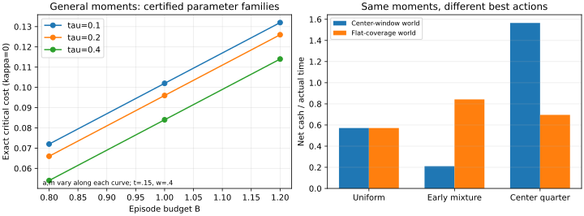

# 机会结构如何改变执行价值

第四轮实质修订，2026-10-11。推广成功总量、时间位置和基础周期；新增未知基准的联合行动认证及同一报价模型下的事前净购买条件。

## 摘要

相同的机会总量和时间位置，并不决定什么时候执行：机会失效后能否重新有效、以及市场被允许怎样收费，也会改变执行保证。本文在期望有效区间数约束和非负中性时机报价下，给出均匀执行停止改进的全参数准确判别；在可核查的闭式区域，构造达到门槛的合法机会，并证明原固定参数结果处于可独立扰动的参数族中。进一步，在基准收益未知时，用完整随机等待日志同时估计多个候选的净现金与实际周期，给出联合行动证书。最后，以同一收费制度比较付费学习和事前最佳固定菜单行动，得到计入训练、误选、记录费和期末闲置的共同截止日净购买条件。核心结果刻画结构信息的执行价值；统计与购买结果使用标准工具连接决策，未声称一般最优学习或市场实证。

## 1. 问题与贡献

交易者可以知道一类机会平均有多大，却仍不知道该在什么时候执行。机会可能刚出现时尚未具备成交条件，随后成熟，又被撤销、竞争交易或合同过期终止。随机等待后执行，并保留失败记录，能够测量这条时间关系。

本文进一步问：相同的几个读数，为什么有时支持不同的执行保证？答案来自机会结构。一份机会只有一个连续有效窗口，就排除了某些反复出现的最坏收益形状。这个限制有可计算的经济价值。若机会可能重新有效，价值会逐渐改变；我们计算改变的准确边界。

三个问题组成主线，结论的信息条件如下。

1. 结构与报价何时消除调整价值：给全参数准确判别，并在一个可验证的参数区域给准确闭式门槛和合法达到世界。
2. 读数和均匀收益均不准确已知时如何选择行动：给事先有限菜单的联合证书，估计费用与成功后周期，控制错误排序。
3. 信息何时值得购买：在同一非负报价制度下，相对事前最佳固定菜单给净价值下界；用相同矩、相同单窗口上限而最佳行动不同的世界说明机制。

层集、矩对偶、分式目标换算、重要性采样和付费学习都是已有方法。本文待核验的中心贡献是具体机会约束下的准确执行关系与可实现的最坏世界。现金证书用于说明部署条件与信息购买的区别。第6节逐项列出既有理论、本文准确求解的候选贡献和尚未验证的应用条件。有限菜单学习不是新算法；理论重点是结构约束与报价权限共同产生的准确停止边界。

|结果|信息与收费制度|结论范围|
|---|---|---|
|定理1—2：一般结构门槛|已知a、m、可信B；非负中性报价|全参数准确判别；可行区域内闭式达到|
|定理3：联合行动认证|未知具体曲线、费用及均匀率；已知周期模型与报价上限|事先有限菜单，含不执行；同时控制估计与选择|
|定理4：事前净购买|环境先验、固定菜单及付费反馈权限|同一报价制度，相对最佳未购买固定菜单的共同期限净价值|
|制度分离与旧两世界例子|直接调整收费或非负报价，各自明确|说明权限影响；不替代一般门槛或最优购买理论|

定理1—2回答已有结构信息能够保证什么；定理3处理观测精度；定理4另外比较不购买时已经能做的行动。证明与信息条件不能跨层省略。

## 2. 观测、机会与现金

每份机会先按固定规则选入，再私下抽取等待D∈[0,1]。到时尝试固定数量交易。成功记Z=1，失败记0；所有尝试、失败费用、到账和解锁时间均保留。D独立于该份机会的潜在有效状态，机会之间独立。

一份机会在若干互不重叠区间有效。其区间数为K，EK≤B；相同机会的执行结果仍只有0或1。平均成功曲线为f(t)=P(时刻t有效)。两个测量读数为

    a=∫₀¹f(t)dt，m=∫₀¹tf(t)dt。

单窗口[A,E)下，a=E(E−A)，m=E[(E−A)(A+E)/2]：一个表示有效时段总量，另一个表示时间位置。均匀日志直接估计EZ和EDZ。

市场在私有等待揭晓前确定非负时机费用c(t)，∫c=C。费用不改变机会状态及结算条件。每笔净现金Y=Z−c(D)，实际周期J=τ+D+κZ，τ>0。κ≥0表示成功后额外的资金占用。等待密度r的长期现金率为

    V(r;f,c)=E_r[Z−c(D)]/[τ+E_rD+κE_rZ]。

一般结构定理使用τ>0，周期J=τ+D+κZ，均匀基准v0=(a−C)/(τ+.5+κa)。原a=.5、m=.25、τ=.2保留为可复核的推论；此时v0=(.5−C)/(.7+.5κ)。允许不执行。准确长期边界允许任意大的有限报价上限；逐笔付款时则必须给定实际报价上限和本金需求。

有限期另记S(H)：截止H全部已结算交易的净现金，扣除全部研究费。S(H)>0、S(H)>v0H、收回研究支出和每笔开始时能付款，是四个不同问题。开始新周期前留足最长周期Jmax=τ+1+κ（τ=.2时为κ+1.2），最后空闲时间也扣除基准现金。

### 一个具体制度接口

有期限的固定数量报价提供机会ID、固定金额、到达和过期。0x Protocol官方RFQ文档给出这些字段，也列出过期、取消、余额或授权不足等失败条件。[官方订单说明](https://docs.0xprotocol.org/en/latest/basics/orders.html)、[成交与取消条件](https://docs.0xprotocol.org/en/latest/basics/functions.html)。

本文将其作为受控报价实验的接口，而非现行RFQ收费制度的实证模型。文档说明RFQ没有taker fee和protocol fill fee，本文的平均中性费用表和记录购买费均须另有合同依据。

固定价格组合的两条成交腿同时有效时，合同窗口是两者窗口的交集。但余额不足后恢复可能使实际可执行状态反复变化，所以expiry只证明最终期限。B=1还需要足额资产预留、不可复活的终止和固定机会身份。费用平均中性则需要额外合同或受控实验约定。官方RFQ并不保证本文全部条件；它提供的是能够逐项核查的制度接口。[完整协议对应表](../机会窗口模型的金融协议与核查范围.md)列出各项证据。

## 3. 机会结构的准确价值

先确定什么形状能由合法机会产生。对0≤f≤1的有界变化曲线，取端点迹并在区间外延为0。令

    Q(f)=f(0+)+全部向上变化。

**结构引理。** Q(f)是产生同一平均曲线所需的最小期望有效区间数。因此EK≤B对应Q(f)≤B；Q≤1时存在每份至多一个窗口的实现。

证明的两方向有不同用途。任何机会每次新生效都要增加区间数量，因此Q≤EK。反向取U均匀[0,1]，以f(t)>U决定有效状态；标准层集公式给平均区间数恰Q。Q≤1时把出生和失效累计按相同分位数配对，得到单窗口实现。这里Q是最小可实现预算，实际过程EK可能更大。

### 定理1：全参数的准确停止判别

令F(a,m,B)是满足0≤f≤1、两个给定时间矩及Q(f)≤B的非空曲线集合。定义w_*为能够被某条合法曲线覆盖的最高直线高度：

    w_* = max{w≥0: 存在f∈F(a,m,B)，f(u)≥w(τ+u)}。

在0<C<a时，均匀达到最佳稳健保证，当且仅当

    C≥C_*=[a−(τ+.5)w_*]/(1+κw_*)。

低于门槛，有同一条有界等待密度，对全部合法机会和报价严格优于均匀。C≥a时，不执行给准确稳健值0。它是全参数的判别；求w_*的全域闭式表达尚未完成。

直观上，市场若能把合法机会放在一条足够高的基础时间直线上，就能用非负费用逐时抵消选时优势。结构预算决定这条直线能有多高。证明使用紧凸集合和标准极小极大，但准确的直线高度还需要机会约束的分析。[新增证明S10](第四轮新增核心证明_一般参数与未知基准.md)。

### 定理2：一个开放参数区域内的闭式门槛

定义Aτ(t)=τ+.5−(τ+1)t+2t²，Mτ(t)=τ/2+1/3−(τ+1)t²/2+4t³/3。求0<t<.5的根

    (m−Bt²/2)Aτ(t)−(a−Bt)Mτ(t)=0，w=(a−Bt)/Aτ(t)。

只有通过以下全部条件的根，才使用闭式门槛：

    w>0，B−(τ+1)w≥0，B−w(1−2t)≤1，(τ+1)w≤1。

此时w_*=w，且合法达到曲线为

    f_*(u)=w(τ+2t)+[B−(τ+1)w]1{u<t}+w(u−2t)_+。

每份机会可实现为至多两段有效，最小平均区间数恰B。每个合法窗口的一条共同积分不等式给w_*≤w，达到曲线给反向等号，因此不是仅靠有限网格得到的猜测。

原固定参数族在严格高度上限内；隐函数导数不为0，因此a、m、B、τ可以独立扰动。这是改变成功总量和机会时间位置的推广，超出单位重标。若根违反高度条件，可能需要新的饱和形状，不能继续套用公式。等待上限L≠1可作时间归一化，但这与独立扰动参数的推广分开。[可行条件与完整证明S10](第四轮新增核心证明_一般参数与未知基准.md)。

### 推论1：原固定参数的准确报价边界

假设a=.5、m=.25、1≤B≤1.3及第2节机会与报价条件。令t_B为(0,.5)内唯一根

    40Bt⁴−80t³+(96−42B)t²+(52B−36)t−5=0，
    w_B=(.5−Bt_B)/(.7−1.2t_B+2t_B²)，
    C_*(B,κ)=(.5−.7w_B)/(1+κw_B)。

在0<C<.5时：C<C_*，存在一条有界随机等待规则，对全部相容机会和报价严格优于均匀；C≥C_*，存在同一个合法机会过程和有限非负报价使均匀达到准确最佳稳健保证。C≥.5时最佳稳健值为0，由不执行达到，C=.5时均匀并列。

**证明要点。** 所有规则都被均匀限制，当且仅当存在合法f高于直线w0(.2+t)，w0=(.5−C)/(.7+κC)。达到世界为

    f_B(u)=w_B(.2+2t_B)+(B−1.2w_B)1{u<t_B}+w_B(u−2t_B)_+。

它在[0,1]内，两个矩准确匹配，Q=B；每份达到机会至多两段有效。另一方面，给每个有效区间同一积分不等式，再按区间数求和，限制所有合法世界的直线高度≤w_B。两方向相合，解w0≤w_B得到C_*。完整连续证明与根唯一性见[补充材料S1](第一篇重大修订证明与补充材料.md)。

|B|1|1.1|1.2|1.3|
|---|---:|---:|---:|---:|
|κ=0临界平均费用|.118638|.114495|.111484|.109233|

在C=.11、κ=0，调整的严格稳健价值保留至B<1.2627516234483673。超过这一结构预算后，合法报价可以消除优势。预算增大表示可允许的机会形状更多；收益总量和时间位置完全相同。

两个时间读数不能认证B。甚至逐格知道∫f和∫tf，也可遗漏格内反复变化：f_n=.5+.25cos(2πnKt)与平坦曲线具有相同K格读数，Q=.75+nK/2却无界。B应来自协议、完整状态记录或可信上限。仅靠平滑拟合得到的形状不能认证结构预算。

### 命题1：收费权限会改变最佳行动

在a=.5、m=.25、τ=.2、κ=0、C=.08，直接按ΛTV(r,1)收费时，Λ≥.4使均匀的准确稳健现金为.6。若费用改为非负、均匀平均C固定的时机报价，则无论报价价差多大，r=2(1−t)都至少保证.6375。

后者因为毛收益2(a−m)=.5、平均等待1/3、平均费用≤2C，所以现金≥(.5−2C)/(.2+1/3)=.6375。前者有合法单窗口上界世界达到.6。相同收益读数产生不同执行结论，源于市场被允许怎样收费，而非统计量名称。完整上界世界与证明见当前补充材料S2。

## 4. 从结构边界到可执行证书

准确边界告诉我们是否存在改进。执行还需要一条具体规则、足够精度和可承担的测量成本。

### 定理3：基准未知时，同时认证与选择行动

不假定a、m、C或均匀率准确已知。事先固定M条候选密度，包含均匀；r_j≤R_j，等待均值d_j=∫t r_j已知。报价未知但0≤c≤c_bar，τ、κ与周期公式已知。均匀采集N条完整日志，用同一数据估计

    Ahat_j=平均[r_j(D)(Z−c(D))]，
    zhat_j=clip_[0,1](平均[r_j(D)Z])，
    vhat_j=Ahat_j/[τ+d_j+κ zhat_j]。

令bmin_j=τ+d_j、Ycap=max(1,c_bar)、s_N=sqrt[log(4M/δ)/(2N)]，

    e_j=R_j(1+c_bar)s_N/bmin_j+Ycap κR_j s_N/bmin_j²，E_N=max e_j。

至少1−δ概率下，全部真实率同时落在vhat_j±e_j。只有候选下界超过均匀上界，才认证严格优于真实均匀；选择最大下界，且下界非正时不执行，部署率至少max(0,v_*−2E_N)。v_*是给定世界的菜单最佳非负率。

这里同时处理了基准误差和选择多个候选的误差。已知等待分布的平均等待不必再次估计；κ=0时分母准确已知，成功与费用只影响分子。候选不能用同一日志任意拟合后继续套用这个有限菜单界。[新增证明S11](第四轮新增核心证明_一般参数与未知基准.md)。

### 固定参数下的专用探针

原现金方向探针仍是一个可执行的专用设计：a=.5、m=.25、C=.11、B=1、κ=0时，范围最优的重加权设计给262356条记录的充分预算，均匀探针需要1049420条达到同样的取得证书概率。该设计假定费用和结构上限已认证；定理3则直接处理未知基准和有限菜单，适用信息不同。完整设计、结构联合读数及功效证明见[补充材料S4](第一篇重大修订证明与补充材料.md)。记录预算本身不证明值得付费。

### 4.1 同一报价模型下的有限期限部署证书

保持第2节的机会和收费模型，增加实际报价上限0≤c(t)≤c_bar、独立同分布周期与充足预付资金。a、m和C已知，因此均匀率v0已知且非负。候选密度r事先固定，0≤r≤R。均匀采集N条完整周期，记录

    X=r(D)[Z−c(D)−v0J]，μ_r=EX。

μ_r>0恰好表示候选的长期现金率超过均匀。X的取值落在[−R(c_bar+v0Jmax), R(1−.2v0)]，可用范围长度L=R[1+c_bar+v0(Jmax−.2)]。令e=L sqrt[log(1/δ)/(2N)]，只有X_bar>e才部署候选，否则继续均匀。它适用于全部符合条件的机会曲线和报价，不要求两个候选世界或先验。

**部署证书。** 若真实μ_r≥d>0且d≥2e，取得部署批准的概率至少1−δ。H≥(N+1)Jmax时，均匀采集后这套流程相对资金充足的持续均匀，其共同截止日期望净现金差至少

    (1−δ)d[H/Jmax−N−1]−Nℓ−v0Jmax，

ℓ为每条完整记录的额外费用。训练交易收入已经计入，末尾闲置已经扣除；最后没有未结算周期。这里只给相对均匀的充分条件。若d在购买前未知，公式用于评价一个有该余量的任务，并不凭观察到的正证书倒推出事前购买必然值得。完整证明见补充材料S8；未知基准与多候选的扩展采用定理3。

### 4.2 与不购买时可做的行动比较

结构保证可能已经使某个候选在全部相容世界优于均匀。此时记录的作用是核查模型、估计收益或支持其他行动，不能将候选原本的收益归给购买记录。

具体地，固定世界中v_r>v0，菜单仅含r与均匀。任何先买N条均匀记录、再从菜单选择的流程，相对立即执行r的期望净价值至多

    v_r Jmax−N[(v_r−v0)J0+ℓ]，J0=.7+.5κ。

超过右侧非正的记录量后，这类购买流程不如直接执行候选。有限期尾部允许至多v_rJmax的误差，结论已把它保留。补充材料S9给证明。5节的正购买任务有不同机制：不同世界可能支持不同的菜单最佳行动，记录帮助避免选错。

## 5. 在一个明确任务中，测量是否值得购买

### 5.1 定理4：同一报价模型的事前净购买条件

在定理3的模型下，给定环境先验Π；实际环境一次选定后固定，环境内机会独立。所有菜单行动的率非负。未购买者可按先验随机选择一个固定菜单行动持续执行，或不执行；购买者先取得N条均匀完整记录，再选择。免费取得同等反馈和自适应探索须另列比较，不能默认为不可用。

定义v_oracle=EΠ[max_j v_j]，v_static=max_j EΠ[v_j]，ΔΠ=v_oracle−v_static。这个差表示知道环境标签究竟能改变多少行动收益；它不是候选相对均匀的增益。

设Jmax=τ+1+κ，每条记录额外费ℓ，H≥(N+1)Jmax。全部支出与已结算收入进入同一截止日，开始前留足最长周期，足额资金预留。购买流程相对最佳未购买固定菜单的期望净价值至少

    H[ΔΠ−2E_N−δ(1+c_bar)/τ]−(N+1)Jmax/τ−Nℓ。

右侧正便给充分购买条件。误选损失、训练占用、记录费与尾部闲置全部保留。若各世界最佳行动相同，ΔΠ=0；仅把同一行动认证得更精确，不能产生本条件中的正信息价值。该界不要求两个世界或直接调整收费，但仍限定先验和固定菜单，并不求所有学习方式的最优价格。[完整证明S12](第四轮新增核心证明_一般参数与未知基准.md)。

**同一结构信息，却有不同最佳行动。** 取τ=.2、κ=0、固定非负报价c=.1。A每份窗口固定[.25,.75)；B每份以概率.5全期有效，否则不存在。两者a=.5、m=.25，都满足同一单窗口上限B=1。菜单是均匀、早期混合r_E=.4+2.4·1{t<.25}、中心四分之一r_C=4·1{.25≤t<.5}。

|世界|均匀率|早期混合率|中心规则率|
|---|---:|---:|---:|
|A|.571429|.210526|1.565217|
|B|.571429|.842105|.695652|

Π(A)=.25时，事前最佳固定菜单率.913043，完整信息率1.022883，ΔΠ=.109840。数据有价值，是因为它在A支持中心规则、在B支持早期规则，而不是因为均匀本来很差。

δ=.001、H=10^8、ℓ=.001时，以下是解析充分界，并非实际现金模拟：

|记录N|联合率误差E_N|共同截止日净价值下界|
|---|---:|---:|
|100000|.052440|−654160.45|
|300000|.030276|2578405.21|
|1000000|.016583|1116367.46|

过少数据不能认证，过多数据消耗部署期。这里未求最优N；展示的是统计精度与可兑现期限必须共同选择。10^8个模型时间单位意味着很强的稳定期假设，没有真实经济单位校准，不据此声称机构可部署。

左图的每条曲线沿可验证参数族同时改变a、m，不应解释为固定两矩的B比较；固定两矩比较仍见第3节原参数图。右图在两世界保持a、m、B和报价相同，显示菜单行动的差异。

### 5.2 与原购买示范的关系

原直接调整收费的两世界任务仍保留在[补充材料S3](第一篇重大修订证明与补充材料.md)：38148条记录、H=1000000、每条费用.001时，购买净价值下界75.28795。它的较小预算依赖针对已知两世界的专门识别读数；定理3—4则评价一般有限菜单和未知净率。两者不处于相同收费、菜单和误差任务，不能将记录数直接解释为方法优劣。

当前主线采用5.1的同一非负报价模型。负下界只表示该充分证书不能建议购买；研究费若不是获取反馈的必要条件，须加入免费学习再比较。期限指数、资金余额及固定市场差异对照仍在补充材料，均按各自任务解释。

## 6. 验证、相关研究与适用范围

### 新推广的独立核验

18组有理参数跨τ=.1/.2/.4、B=.8/1/1.2和不同时间位置，总计15498个准确窗口检查。独立逐格线性优化使用80/160/320格，共54次，仅约束两个矩、概率上限、正变化预算和整格底线；没有把达到公式写入约束。全部可行底线低于解析上界且随网格细化接近。连续准确性由定理2证明，网格不替代证明。

未知基准的菜单选择另用256组独立训练日志、每组2000条；联合区间全部覆盖真实率，中心世界128组均选中心规则，平坦世界126组选早期、1组选均匀、1组选中心。另用非恒定报价与κ=0/1/12检验192组日志，联合区间均覆盖。κ=12的保守半径最大约3.645，通常没有足够决策精度；覆盖不等于能够批准。以上是合成估计核验，不是概率证明，也不是30万条付费方案的共同期限现金模拟。[第四轮修订与验证报告](第四轮实质修订与验证_20261011.md)给范围及残余问题。

### 统一合成比较

384组环境与方法组合，每组256条独立路径，比较即时、均匀、两数三角规则、结构规则、付费现金验证和完整信息参照。机会有平坦、中心窗口、B=1达到世界和B=1.3反复有效世界；报价有平坦和早期集中两种；κ=0/12、H=200/2000、初始费用余额.35/500。

所有支出在开始时支付，收入在周期完成时到账。截止前留足最长周期。验证方法拟收集512个完成周期；期限不足时在测量前返回均匀。它报告不批准以及资金中断，而不是强行输出候选。

代表环境为单窗口达到世界、早期集中报价、κ0、H2000。大余额下结构规则平均现金1140.00±1.98，均匀1115.08±1.58，±表示模拟均值标准误。付费现金验证全部拒绝部署认证。小余额下均匀约12%的路径停止付款，结构规则约25%。这说明长期现金改善和资金安全需要分别评价。

完整报告给现金分位数、正现金、超过持续基准、付款停止、验证完成及批准比例。[统一比较与核心图](重大修订统一比较与核心图.md)保留全部定义。完整信息免费、使用网格选时，只作理想参照；小余额策略仍与无限余额持续基准比较。合成频率不替代解析保证或市场实证。

准确结构边界另有20个独立逐格有界变化优化，最高640格；它只给可行逼近，连续上界由定理证明。核心根和B临界值用有理夹逼，现金证书用准确分数；所有新脚本和结果保留在experiments。

### 已有方法与本文新增关系

Chen、Hu、Wang的有限信息筛选用对偶、随机机制和最坏分布求准确收入保证；Liu、Meskarian、Xu已给比率目标及矩对偶。它们提供本文计算框架。将未知f作为一般有界曲线求解，会包含违反单窗口预算的世界；本文必须额外刻画合法机会、求解B依赖边界，并给满足0≤f≤1的达到过程。一般框架能表示这个问题，准确根、结构放宽的代价与全部窗口共同证书仍需本模型的分析。

Gong、Zhang及Schur、Lago、Fiez已有付费观察和先学后用研究。本文不把两阶段流程或平方统计复杂度作为算法创新，而把它们接入盈利相关结算、共同截止现金和先付费用条件。Hautsch、Scheuch、Voigt已研究结算等待限制套利，因而“慢结算有成本”也属于已有金融认识。

层集和出生—失效配对属于标准数学基础；Owen的重要性采样章节给权重换算与采样设计。本文使用这些工具计算明确机会协议中的结构价值与测量预算。对B边界的贡献判断须比较相同约束下的准确结果，而非仅比较公式名称。以下列出本次原文核查得到的边界。

### 原创性核查的具体结论

|邻近研究|已有结论与本文关系|本稿的贡献地位|
|---|---|---|
|有界变化与层集公式（Górny，定理1.19）|总变化等于层集周长积分；一维区间对应两端点|Q(f)最小区间预算是该工具的应用，不列新一般理论|
|Galerne（2011）；Galerne–Lachièze-Rey（2015）|由联合覆盖统计研究随机集合的周长与可实现性|机会集合、覆盖与结构正则性已有系统研究；本文只使用单点覆盖及两时间矩|
|Chen–Hu–Wang；Liu–Meskarian–Xu|有限信息、矩对偶与比率最坏优化|提供计算框架；本文增加Q≤B和非负中性报价并求具体准确门槛|
|Owen；付费观察与先学后用文献|重加权估计、采样设计和付费选择|4.1及5节用于明确现金比较，不作为通用最优测量理论|

本稿中心候选是：在给定两个时间矩、区间预算及报价权限下，准确求出C_*(B,κ)，并给全部合法窗口共同上界和达到它的机会过程。层集刻画和最坏优化形式已有来源。对随机集合原文的本次核查集中定义、周长关系及可实现性定理，尚未完成全部证明和后续文献的排除；B边界的原创性仍待完整近邻审查。

### 更具体的近邻比较与尚未解决的问题

本轮对作者全文进一步核查：Liu–Meskarian–Xu预印本§2的Proposition2.1将奖励—风险比改写为稳健余量约束，§4也处理矩的估计误差。因此“分式换算”和“把矩变成区间”都不是本稿创新。Chen–Hu–Wang作者附录C.1的Theorem5在均值方差约束下构造筛选最坏分布与随机机制；准确边界和达到世界本身也属于成熟研究路线。[比率优化原文](https://optimization-online.org/wp-content/uploads/2015/01/4752.pdf)、[筛选作者附录](https://optimization-online.org/wp-content/uploads/2021/10/8626-1.pdf)。

Galerne–Lachièze-Rey §4 Theorem3研究局部协方差图在平均周长约束下的随机集合可实现性；它与本稿的单点覆盖曲线、两个时间矩和执行现金率对象不同，但足以排除将“结构预算与合法随机集合”本身称为首次发现。[作者全文](https://arxiv.org/html/1405.6333v3)。

本稿具体新增候选集中在：非负中性报价与有效区间预算共同决定的准确停止门槛；一般参数区域中的达到曲线；全部合法窗口共同给出的连续上界。定理3—4使用标准估计与决策方法，作用是补全未知基准及净购买比较，贡献强度不能与核心结构边界等同。

这些原文的相关命题未直接给出本文参数化门槛，不等于已经穷尽后续文献或证明优先权。闭式区域之外的高度饱和形状、全体自适应策略的最佳未购买比较、最优付费探索和真实数据校准仍未解决。修改增强了理论适用范围，不以增加定理数量作为顶会水平的依据。

### 应用边界

需要核查三类条件：机会身份和有效区间结构；费用是否在私有等待前确定、是否平均中性；真实到账和下一笔开始是否满足周期权限。结构信息不可靠时，使用更大的B并报告敏感性，或直接验证候选的联合净现金与周期。市场因公开规则而改变机会分布时，原日志的重加权只评价训练环境，部署还需独立验证或明确变化界。

实际使用还需完成三个经济核算。首先，报告记录预算对应多少独立机会、多少真实时间，而非把N当普通价格数据条数。其次，将成功收入1还原成金额，同时计入预留资产、失败费用、数据或审计费。最后，以同一可执行行动菜单比较不购买、免费学习和付费验证；若普通交易已提供完整反馈，则记录购买费不具有必要性。

例如38148条记录的最坏采集时长为83925.6个模型时间单位；262356条证书记录在κ=0时最坏采集时长为314827.2个单位。若一个单位对应一秒、一分钟或一小时，经济含义截然不同。目前没有真实数据校准单位、独立性、稳定期限或报价预算，因此这些数字是模型内可行性门槛。应用报告应分别给出实际机会到达率、可保持不变的部署期、收费合同和完整付款账本；任一项缺失时，保留受控决策理论的定位。

本文给的是这些条件下可计算的执行保证。风险厌恶、价格风险、部分成交、供给耗竭、多资产并发和实际学习反馈可改变决策对象；相应结果需要在完整现金日志中重估。

## 参考文献与复现

- Galerne, B. (2011). *Computation of the Perimeter of Measurable Sets via their Covariogram. Applications to Random Sets*. Image Analysis & Stereology 30, 39–51. [原文](https://www.ias-iss.org/ojs/IAS/article/download/22/10/45)。
- Galerne, B., and Lachièze-Rey, R. (2015). *Random Measurable Sets and Covariogram Realisability Problems*. [作者版本](https://arxiv.org/html/1405.6333v2)。

- Chen, Z., Hu, Z., and Wang, R. (2024). *Screening with Limited Information: A Dual Perspective*. Operations Research72(4),1487–1504. [作者全文](https://iora.nus.edu.sg/wp-content/uploads/2024/02/Screening.pdf)。已读主文相关部分，补读[作者预印本附录C.1定理5](https://optimization-online.org/wp-content/uploads/2021/10/8626-1.pdf)；出版版电子附录未全部核查。
- Liu, Y., Meskarian, R., and Xu, H. (2017). *Distributionally Robust Reward-Risk Ratio Optimization with Moment Constraints*. SIAM Journal on Optimization27(2),957–985. [已读作者预印本](https://optimization-online.org/wp-content/uploads/2015/01/4752.pdf)，2015；最终版全文未核。
- Gong, X., and Zhang, J. (2026). *The Cost of Information: Phase Transitions in Contextual Bandits with Paid Observations*. PMLR306,36013–36044。[原文](https://proceedings.mlr.press/v306/gong26i.html)。
- Schur, F., Lago, J., and Fiez, T. (2026). *The Price of Knowledge: Optimal Algorithms for Costly Bandits*. PMLR337,6064–6090。[原文](https://proceedings.mlr.press/v337/schur26a.html)。
- Hautsch, N., Scheuch, C., and Voigt, S. (2024). *Building Trust Takes Time: Limits to Arbitrage for Blockchain-Based Assets*. Review of Finance28(4),1345–1381。[作者v4](https://arxiv.org/html/1812.00595)。
- Górny, W. BV函数讲义，Theorem1.19。[作者讲义](https://www.mat.univie.ac.at/~wgorny/Teaching/VSM_lecture_BV_functions.pdf)。
- Owen, A. *Monte Carlo*, Chapter9, §9.1。[作者章节](https://artowen.su.domains/mc/Ch-var-is.pdf)。
- MIT, *Discrete Stochastic Processes*, Chapter4。[课程原文](https://ocw.mit.edu/courses/6-262-discrete-stochastic-processes-spring-2011/931ffa0940899c27f34b71ad64fd2bb0_MIT6_262S11_chap04.pdf)。
- 0x Protocol4.1，Orders及Basic Functionality。[官方文档](https://docs.0xprotocol.org/en/latest/basics/orders.html)。

[完整核心证明和原有扩展](第一篇重大修订证明与补充材料.md)、[审稿意见](同行审查意见_20261011.md)、[统一合成比较](重大修订统一比较与核心图.md)。原初稿和收束前长稿均保留。最新实质修改见[第四轮修订与验证](第四轮实质修订与验证_20261011.md)，新增核心证明见[一般参数、未知基准与购买条件](第四轮新增核心证明_一般参数与未知基准.md)。历史有限期公式见[第二轮条件登记](现金公式的协议与条件登记_第二轮.md)，不自动扩展到新增定理。
