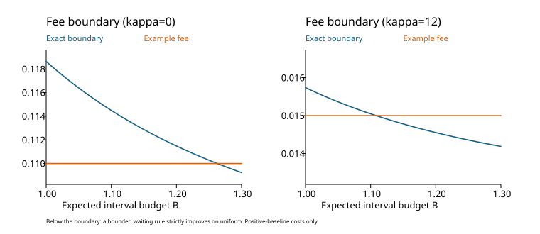
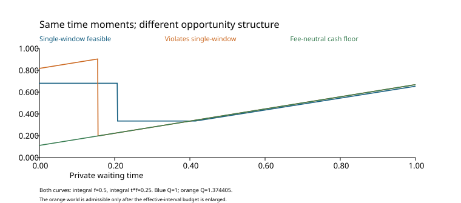
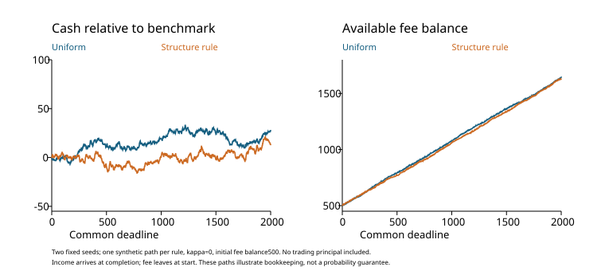

# 重大修订：统一合成比较与核心图

384组环境与方法组合，每组256条独立合成路径。四类机会过程、两种非负中性报价、两个结算速度、两个共同期限和两个初始费用余额；逐笔费用先付、成功后收入到账，所有开始周期在截止前完整结算。

即时执行、均匀、两数三角规则、结构规则、付费独立现金验证和完整信息基准放在同一组环境中。完整信息使用无测量费用的网格最优时刻，仅作理想参照；小余额比较基准仍是无限余额持续均匀现金率，故付款停止后的劣势不能解读成同资金策略排名。

代表环境：单窗口达到世界、早期集中报价、κ0、H2000。均匀持续现金基准1114.286。

|规则|初始费用余额|平均净现金±均值标准误|超过基准路径比例|付款停止比例|
|---|---:|---:|---:|---:|
|立即执行|0.35|2476.29 ± 107.45|0.676|0.324|
|均匀|0.35|981.07 ± 22.45|0.383|0.117|
|两数三角|0.35|876.83 ± 33.07|0.727|0.266|
|结构规则|0.35|853.16 ± 30.90|0.586|0.250|
|付费现金验证|0.35|786.83 ± 31.77|0.344|0.293|
|完整信息参照|0.35|2447.22 ± 108.09|0.668|0.332|
|立即执行|500|3664.50 ± 2.90|1.000|0.000|
|均匀|500|1115.08 ± 1.58|0.531|0.000|
|两数三角|500|1191.44 ± 1.89|1.000|0.000|
|结构规则|500|1140.00 ± 1.98|0.797|0.000|
|付费现金验证|500|1116.73 ± 1.66|0.527|0.000|
|完整信息参照|500|3665.67 ± 3.10|1.000|0.000|

解释：大余额下结构规则的平均现金比均匀更高，但512条直接现金验证在集中报价环境全部拒绝认证。小余额使约12%均匀路径和25%结构规则路径停止付款；长期优势与付款风险在这里明显分开。结算κ12时，H2000不足以保证完成512条训练，验证流程在测量前拒绝，直接返回均匀。

全部方法均报现金5/50/95分位数、均值标准误、正现金比例、超过持续基准比例、付款停止、验证完成和批准比例。比例是256次模拟的频率，不是额外解析证书。budget1_3组有真实反复有效结构，单窗口保证不适用；它用于检查错误沿用结构条件时的风险。

数据与复现：experiments/revision_unified_cash_panel.py/.json；experiments/revision_core_figures.py；figures中的逐笔账本CSV。所有结果为模型内合成验证。